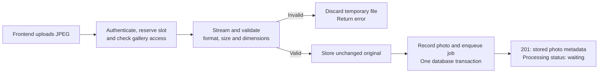

# Upload JPEG proofs to a gallery

Current approved design for #98 (part of #66), implemented in #132.
Requirements: FR-05, NF-01, NF-02, NF-04 and AC-06 in
[the product specifications](../SPECIFICATIONS.md).
Foundations: [photo storage](2026-10-31-photo-storage-design.md) (#96) and
[job queue](2026-10-31-job-queue-design.md) (#97).

## Outcome and scope

An authenticated photographer uploads one JPEG per request and can list the gallery's photos.
Accepted originals stay byte-for-byte unchanged. Each accepted photo has a processing job.
A batch is several independent requests: one failure does not undo successful uploads.

This slice does not include upload UI (#102), image processing (#99), media serving (#99,
#101), live updates (#80), photo removal (#68), duplicate detection or resumable uploads.
The worker currently has no photo-processing handler, so accepted photos remain waiting.

## Upload flow

Origin failure returns 403. Extraction can return 401 for a missing/invalid session or 503
when no upload slot is available; these are not sequential body-processing steps. Eager
admission may return 503 before authentication or gallery/header validation completes.

The route reads as these steps; storage mechanics and database commit recovery stay behind
their respective boundaries. Success returns database metadata, never image bytes and never
a claim that image processing has finished.

The slot stays held through validation, publication, database acceptance and cleanup. Returning
or cancelling the request releases it. Before publication, dropping a staged photo attempts to
remove its temporary file. After publication, cancellation or a crash can leave an orphan.

## Request and response contract

| Item | Contract |
|---|---|
| Upload | `POST /api/v1/galleries/{id}/photos`; raw body; `Content-Type: image/jpeg` |
| Success | `201`, photo metadata, initially `status: "waiting"` |
| List | `GET /api/v1/galleries/{id}/photos`; all states, ordered by creation time then ID |
| Access | Session authentication and workspace ownership; missing/foreign galleries both return 404 |
| Filename | Percent-encoded `X-Filename`, for display only; never used to construct a file path |
| Filename fallback | Missing, invalid UTF-8/escaping, NUL or over 255 decoded bytes becomes `photo.jpg` |

Duplicate filenames are allowed. ZIP entry sanitization belongs to ZIP creation, not upload.
Responses use the shared API error shape and are not cached.

Validation checks headers before reading the body, counts actual streamed bytes even when
Content-Length is absent or inaccurate, rejects empty bodies, then checks the JPEG signature
and parses dimensions without decoding pixels. This is header validation, not a complete
pixel-data integrity check; processing belongs to the worker.

| Rejection | HTTP status |
|---|---|
| Wrong content type | 415 |
| Declared or streamed size above the limit | 413 |
| Malformed Content-Length or interrupted payload | 400 |
| Empty/invalid JPEG header or excessive dimensions | 422 |
| No body chunk for 30 seconds | 408 |
| Admission exhausted, storage full or infrastructure failure | 503 |

## Bounds and ownership

Defaults are 64 MiB per file, 100,000,000 pixels and four concurrent uploads. These are
configurable through `UploadConfig` under the existing `photo_upload` configuration section.
Size/pixel bounds use `NonZeroU64`; concurrency uses `NonZeroUsize`; dimensions use
`PhotoDimensions` with nonzero width and height.

`Data<ApiState>` owns storage, database access and upload validation configuration, but no
upload semaphore. A separate `Data<UploadLimiter>`, constructed once outside the server-worker
factory, privately owns shared capacity. The reverse proxy may add traffic protection but is
not responsible for this application resource limit. Routes select repositories through
`database()`. Missing limiter application data is a wiring error: log and return 503,
not an unbounded upload fallback. Saturation also remains fail-fast.

| Component | Responsibility |
|---|---|
| `routes/galleries/photos.rs` | Gallery authorization, upload coordination and listing |
| `UploadLimiter` | Isolated concurrency limit; privately owns its semaphore |
| `UploadSlot` | Extracted capacity guard only; no application state, staging or inspection |
| `PhotoUpload::from_request` | Explicit constructor after authorization: check headers, receive bounded bytes into storage staging, inspect JPEG and decode display filename |
| `upload/jpeg.rs` | Process-wide libvips initialization and file-based JPEG inspection; no storage or database policy |
| `ErrorResponse::from(StorageError)` | Log storage failures and map them to the shared HTTP error contract |
| `PhotoStorage` / `StagedPhoto` | UUID-derived paths, temporary files, write-once originals, durability and incomplete-publication cleanup |
| `PhotoIntake` | Photo/job transaction and one bounded retry after an uncertain commit |
| `PhotoRepository` / `JobRepository` | Focused persistence operations within that transaction |

`PhotoUpload` replaces `ValidatedPhoto`; the route calls its value `photo_upload`. Its
constructor takes the request, body, storage and upload options. This is an explicit async
method, not an Actix extractor: authorization must finish before receiving bytes. It returns
the staged original, filename, size and dimensions; the route still commits storage and builds
`NewPhoto` explicitly. JPEG inspection takes a path and pixel bound, not `PhotoStorage`.

UUID-backed identifiers implement a shared `Generate::generate() -> Self` capability in core.
Production ID creation uses the identifier type, not `Uuid::new_v4()` at its callers. Preserve
existing conversions, serialization and public fields; changing representations is not in scope.

## Publication, acceptance and failure handling

Publish the original before committing its photo/job transaction. The filesystem and
PostgreSQL do not share a transaction; this ordering favors preserving originals over
preventing every orphan.

- Storage never replaces an existing original. Errors before publication must not remove one.
  If publication creates an original but its durability barrier fails, storage removes that
  attempt's original before returning the failure. Failed removal is an explicit storage
  cleanup error. The route does not interpret publication phases.
- `PhotoIntake::try_accept` runs one transaction through private `accept`: recheck gallery
  ownership, insert the photo and enqueue its `process_photo` job. Both database writes commit
  together. The transaction-taking photo insertion remains separate from job persistence.
- An uncertain commit triggers one retry with the same ID and identifying metadata. An
  identical row is reused without another job; conflicting metadata is an error.
- PostgreSQL FATAL/PANIC or unavailable commit severity remains uncertain. If retry cannot
  settle the outcome, preserve the original: deleting it could destroy an accepted photo.
- A missing gallery after streaming returns 404 and removes the newly published original.
  A definite database failure returns 503 after cleanup. Cleanup failures are reported, not
  treated as successful removal.
- Database failure branches live directly in the route, not in upload helpers. They call
  `storage.remove` only for definite failure or a missing gallery; `NotFound` means already
  removed, preserving existing behavior. Unknown commits log and return 503 without removal.

**Known recovery limits:** a crash/cancellation between publication and database acceptance
can leave an original without metadata; uncertain commits and failed cleanup can also leave
files for later reconciliation. Abrupt process termination can leave temporary files.
Automatic orphan reclamation is not implemented in this slice.

| Failure | Owner and action |
|---|---|
| Invalid/interrupted upload | Validation returns an error; staged-file drop discards temporary bytes |
| Incomplete original publication | Storage cleans its own new file; preserves older originals |
| Gallery gone or definite database failure | Route removes the new original, then returns 404 or 503 |
| Uncertain database commit | Database retries once; if unresolved, route preserves the original and returns 503 |
| Cleanup failure | Return an infrastructure error; never claim successful cleanup |

## Stored photo and processing status

PostgreSQL stores ID, workspace/gallery IDs, original name, positive size/dimensions, status,
failure reason and creation time. Its enum is `waiting`, `processing`, `ready`, `failed`;
a constraint requires a reason exactly when the status is failed.

Rust has one `PhotoStatus` enum. Row decoding reads SQL status as text and combines it with
the reason, rejecting unknown or inconsistent pairs. JSON uses `"waiting"`, `"processing"`,
`"ready"` or `{"failed": "reason"}` as the status value. Worker state transitions arrive in #99.

## Chosen approaches and verification

Raw-body requests avoid multipart parsing and make per-file retry independent. Eager typed
admission encodes permit ownership; its overload-before-validation tradeoff is accepted.
Disk-backed receiving avoids up to 256 MiB of upload buffers at the default concurrency and
avoids a new streaming JPEG parser. Its constructor names the receiving/storage responsibility
explicitly; JPEG inspection is separate. Passing a pre-created staged file would create it
before header validation or require another route step. Whole-body memory buffering was not
chosen. Remove the single-implementation JPEG extension trait and upload cleanup wrappers
rather than introducing another publication abstraction. Database transactions remain outside
the HTTP layer, while the route owns the decision to remove or preserve its original.

Keep regression coverage for authorization without body reads, admission and cancellation,
size/timeout/JPEG rejection, unchanged bytes, duplicate names, gallery deletion during upload,
pre/post-publication failures, photo/job atomicity, collision reconciliation and uncertain
commit preservation. #99 must supply processing before this becomes an end-to-end release.
