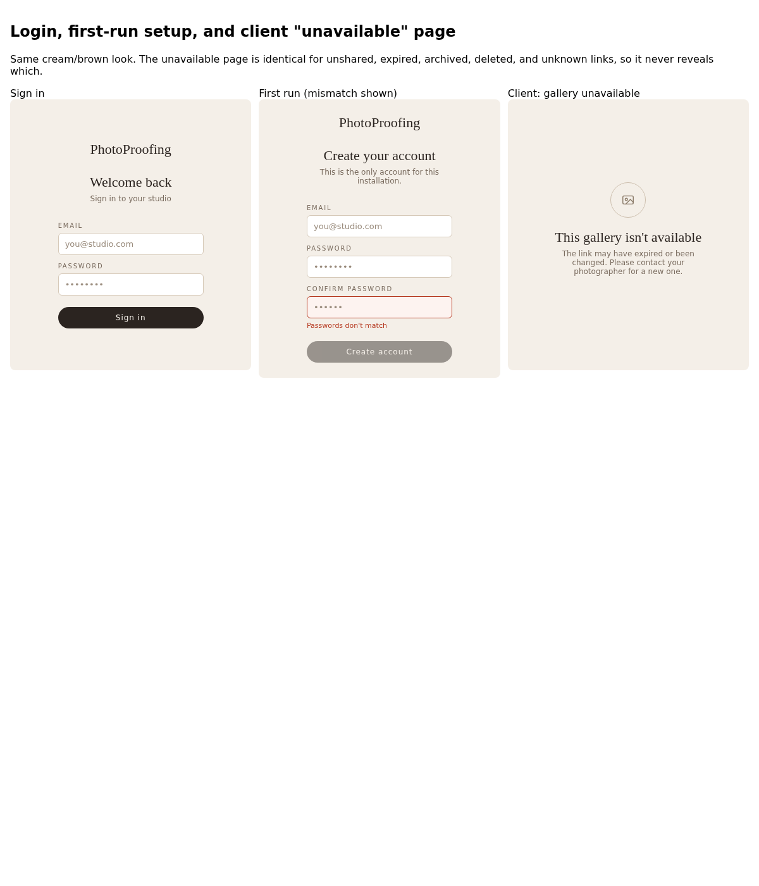

# Sign in and first run

Not part of the redesign: this keeps the earlier mockup. It should use the tokens in
[DESIGN.md](../DESIGN.md) when built. Route `/login`.

Source: [auth/auth.html](auth/auth.html). It covers first-run account setup with password
confirmation, sign in, and the wrong-password error.
