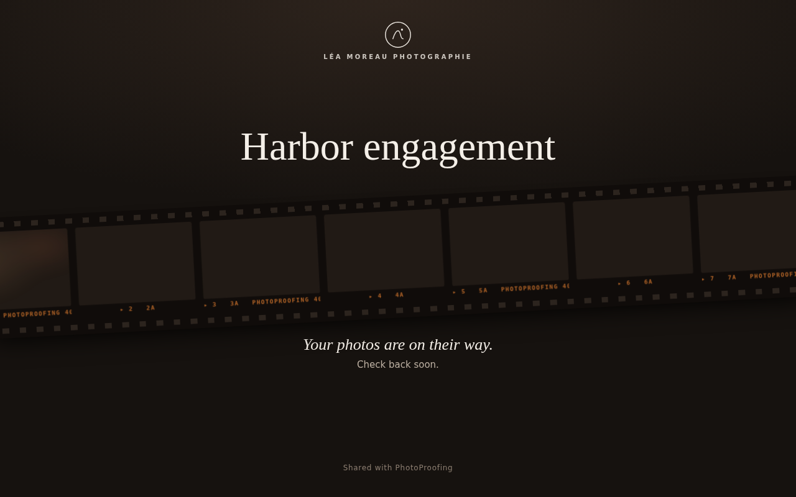
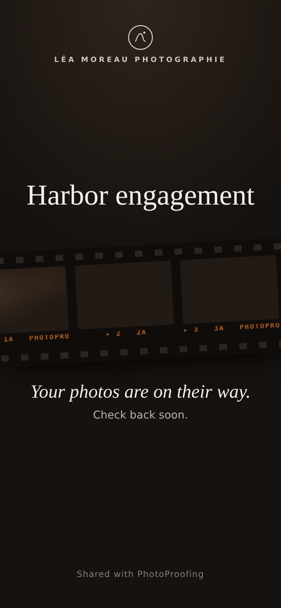
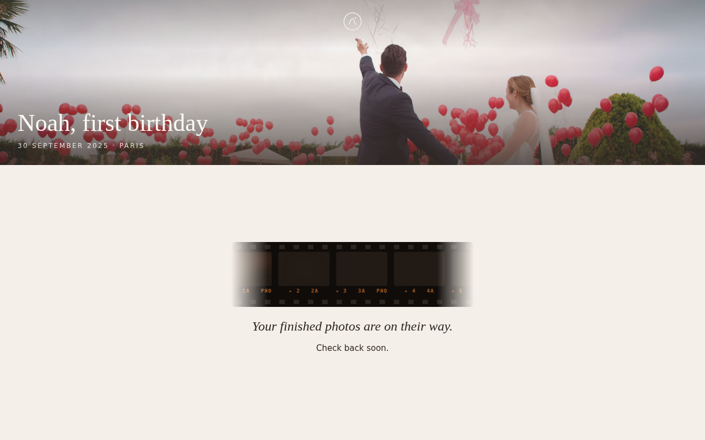
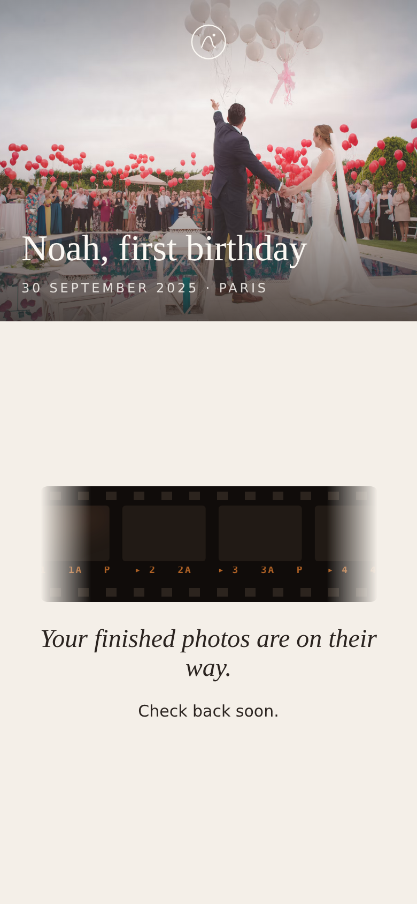
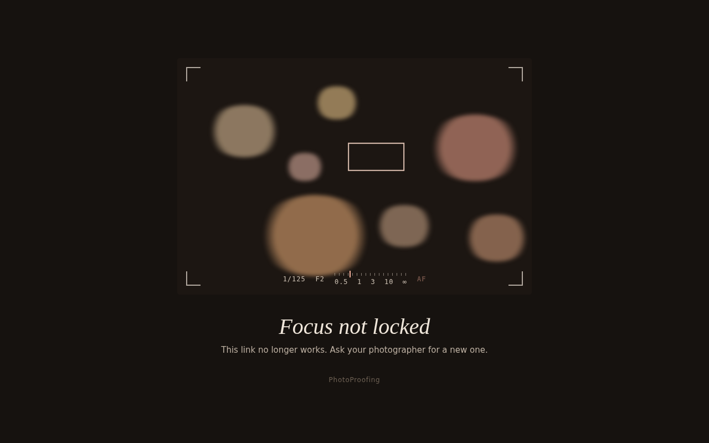
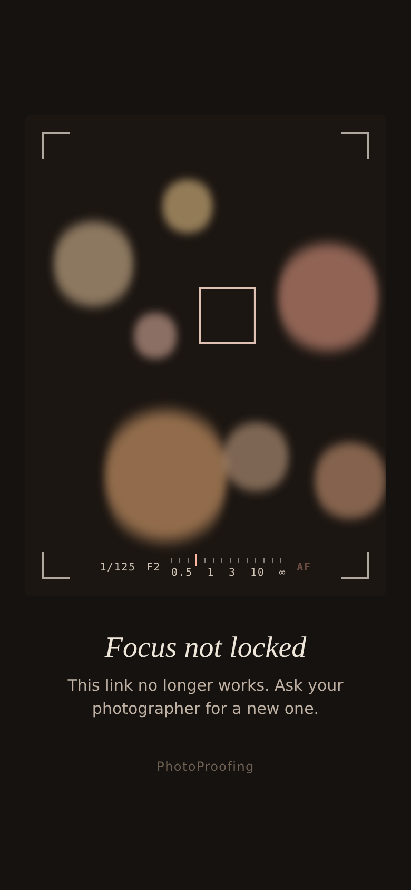
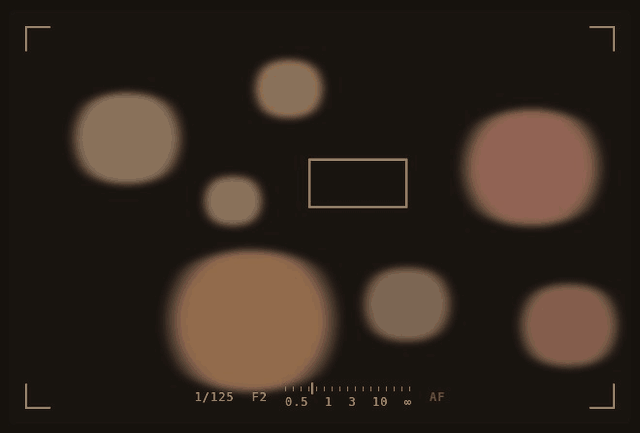
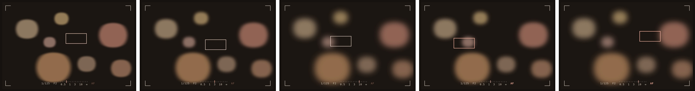

# Client states

What the client sees when there is nothing to show yet, or nothing they may see. All three are
calm pages that use film and camera imagery instead of error wording.

| | Desktop | Phone |
|---|---|---|
| Photos on their way |  |  |
| Finished photos on their way |  |  |
| Unavailable |  |  |

## Photos on their way

A shared gallery with no ready photos. Studio signature, the title in Georgia and the date and
place, a slowly scrolling film strip of glowing blank frames with edge print ("▸ 3 3A",
"PHOTOPROOFING 400" on every other frame), then "Your photos are on their way." and "Check back
soon."

## Finished photos on their way

A delivered gallery with no finished photos. The cover (hero or the no-hero gradient) with the
title, then a short film strip and "Your finished photos are on their way. Check back soon." on the light page. No tabs, no
proofs: after delivery the client only ever sees finished photos.

## Unavailable

One page for every link the client can't use: never shared, expired, archived, deleted or
unknown. It must not reveal which, and shows no studio branding (only a small "PhotoProofing"
footer). A camera viewfinder hunting for focus over warm bokeh: corner brackets, a focus box
that keeps seeking, a distance scale whose needle swings, and a blinking "AF". Below: "Focus not
locked" and "This link no longer works. Ask your photographer for a new one."

