# Client gallery

What the client sees at the private link `/g/{token}`. No account, no branding beyond the
studio's signature.

Right-clicking images in the cover, grid or viewer does not open the browser context menu. On iOS,
long-pressing an image does not show its image callout. These are casual deterrents, not security
features.

| | Desktop | Phone |
|---|---|---|
| Cover | 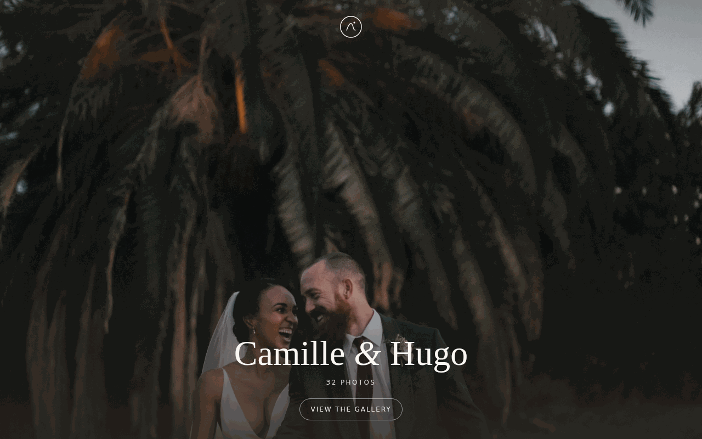 | 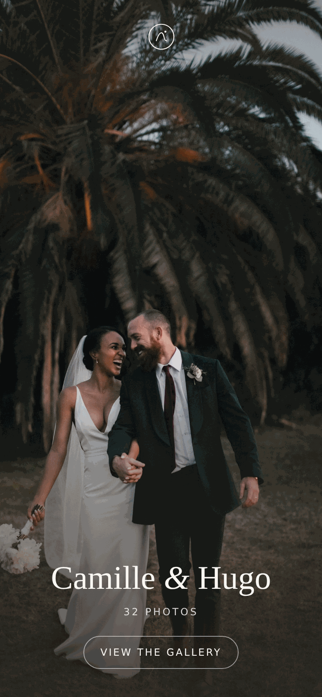 |
| Cover, no hero | 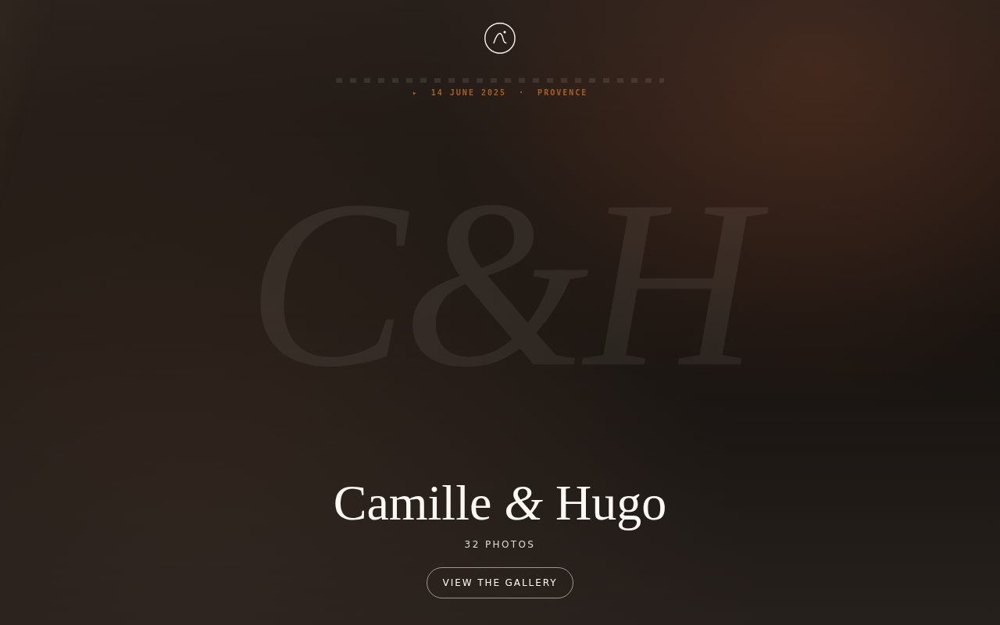 | 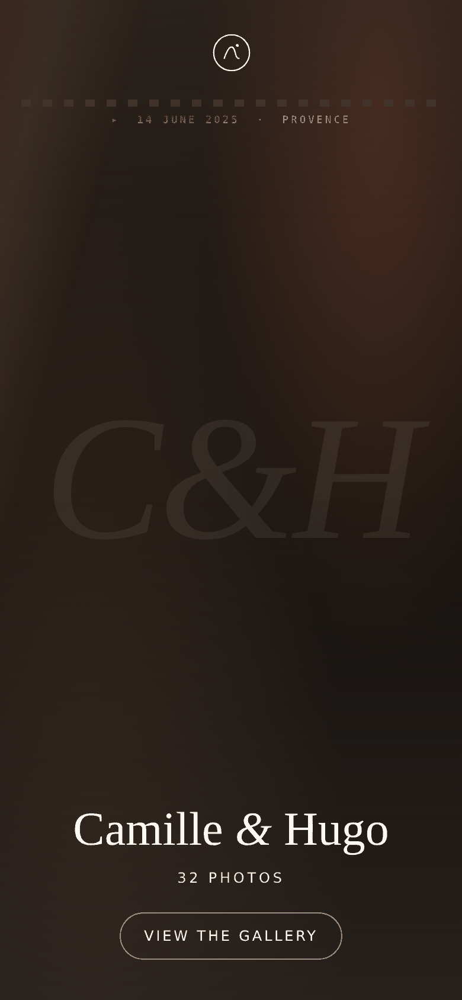 |
| Grid | 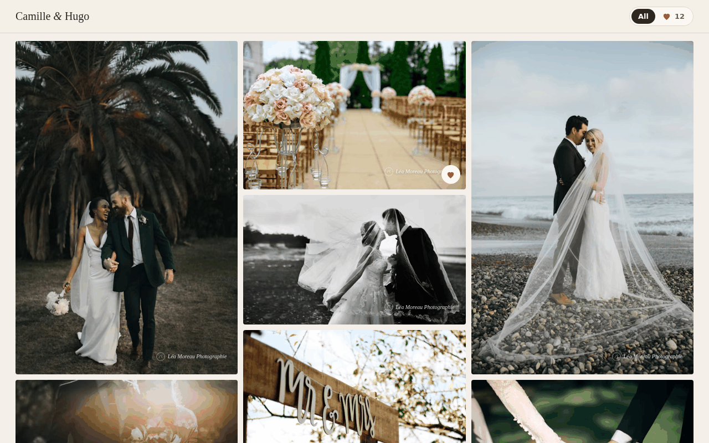 | 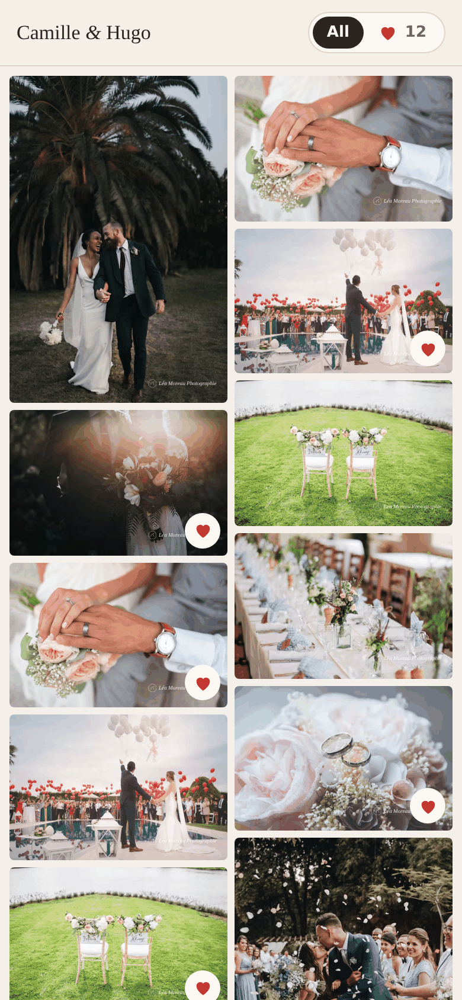 |
| Favorites filter | 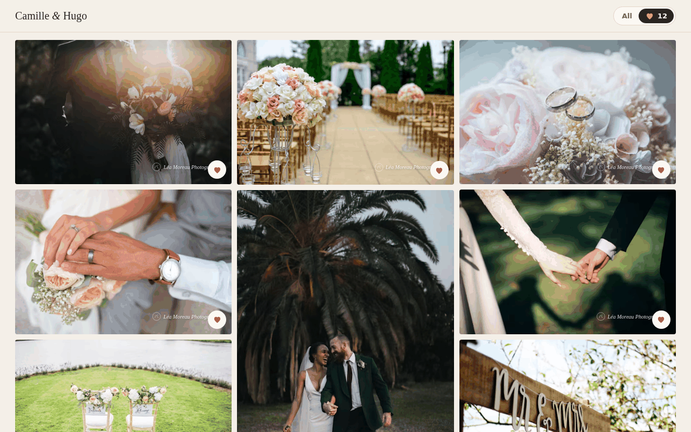 | 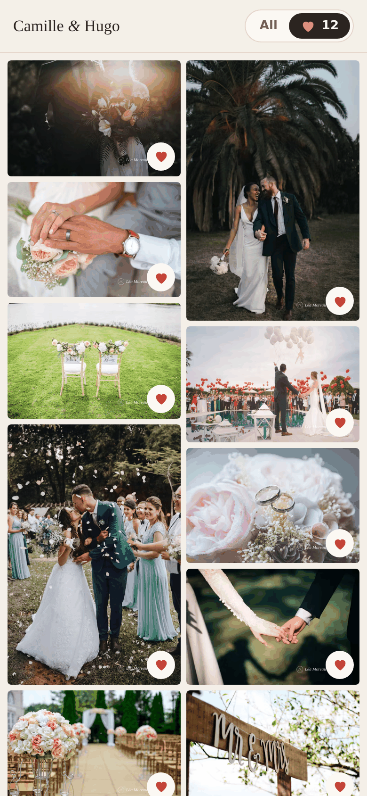 |
| Viewer | 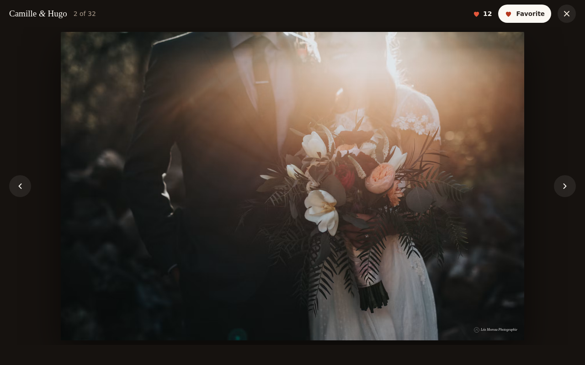 | 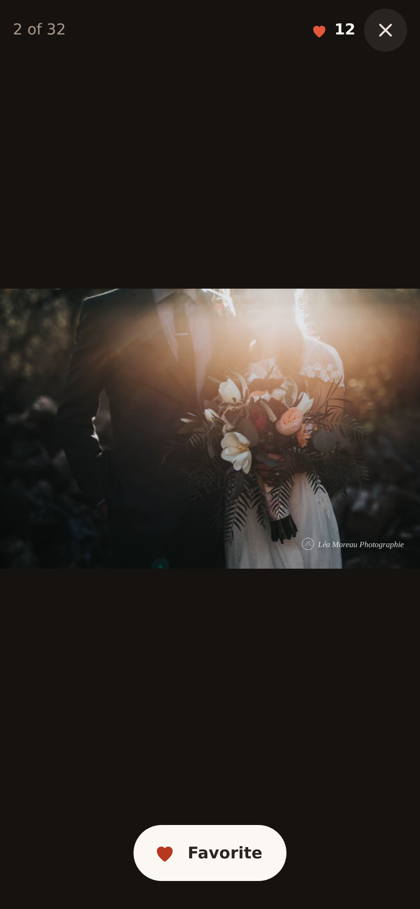 |
| Delivered | 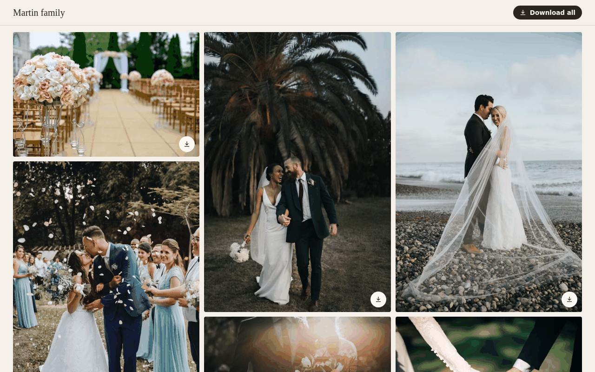 | 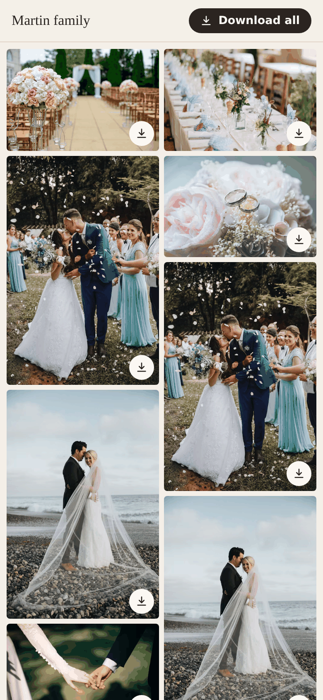 |
| Delivered viewer | 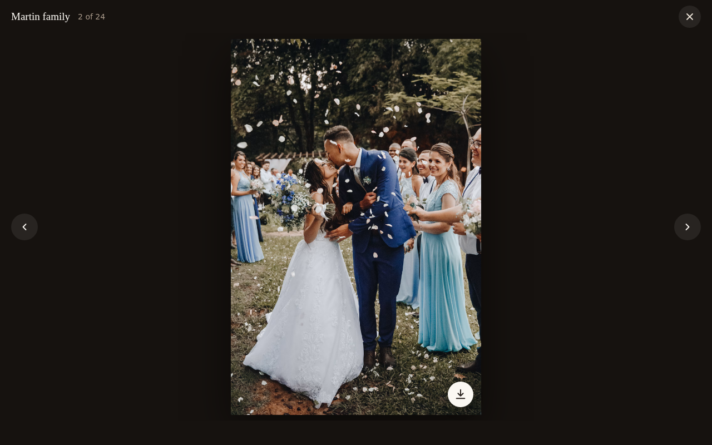 | 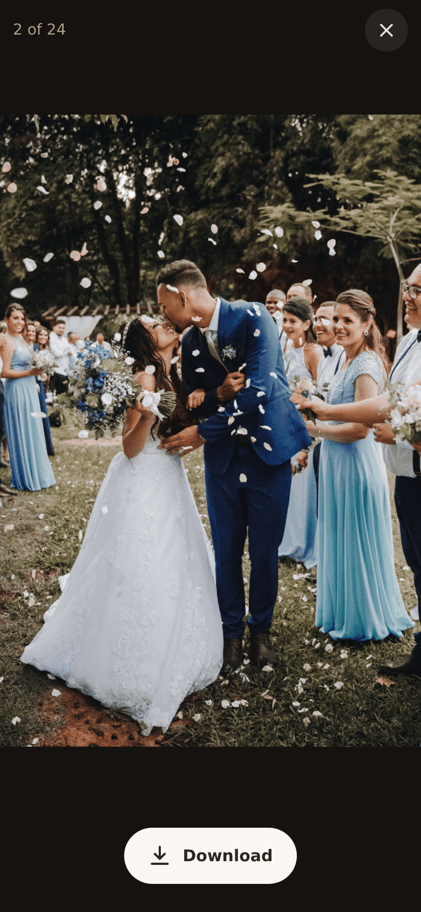 |
| Cover in French | 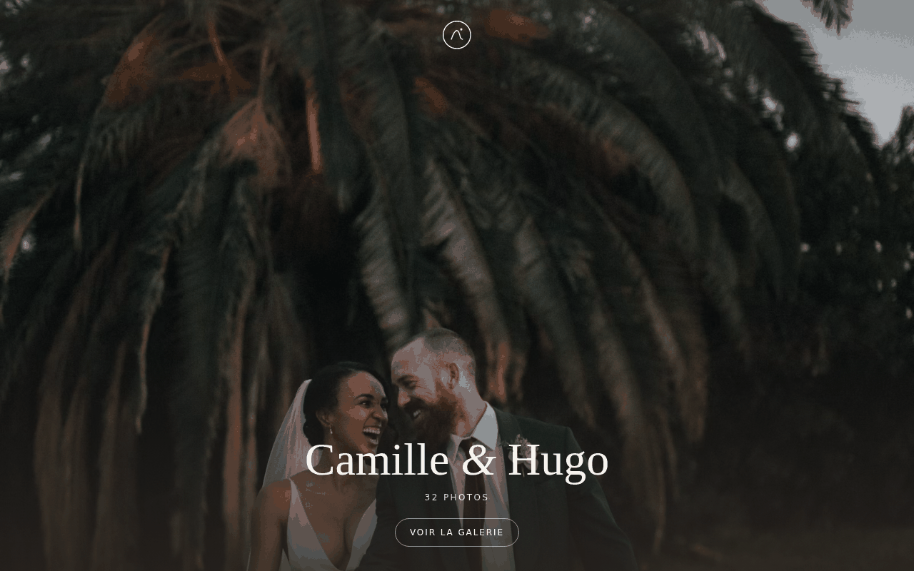 | 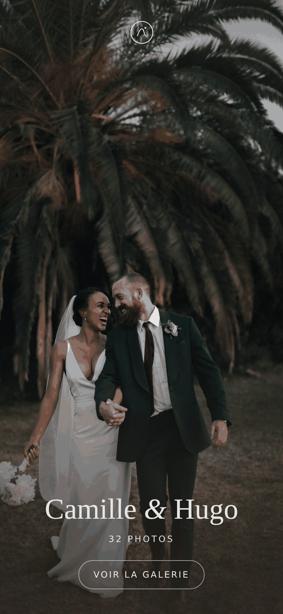 |
| Grid in French | 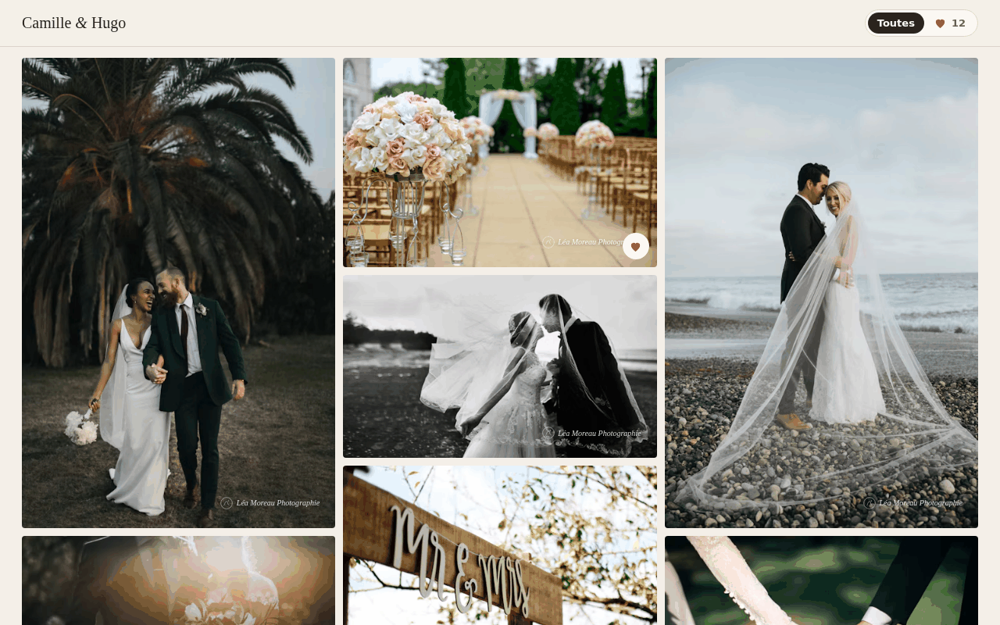 | 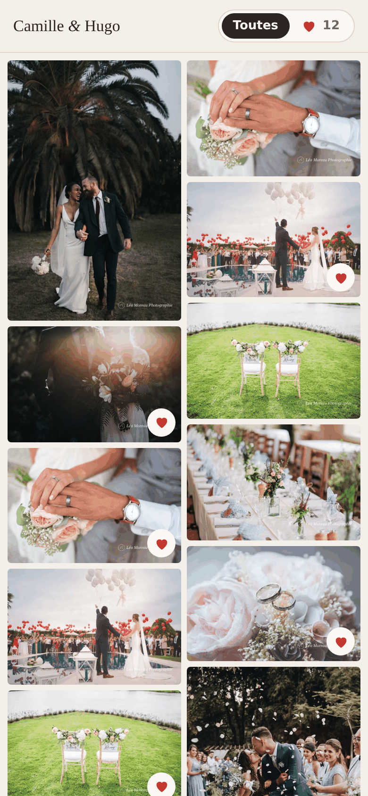 |

## Access-code gate

When an active shared gallery is protected by a 6-digit numeric access code and the client browser
has not unlocked it yet, `/g/{token}` displays a full-screen dark gate:

- **Studio signature** at the top (name, logo, both or none) and **Gallery title** (+ optional
  formatted shoot date) centered over a darkened clean cover photograph (`brightness-[0.38]` with a
  warm dark vignette, or `CoverBackdrop` when no cover photo is set).
- **Frosted 6-digit numeric input** (`inputmode="numeric"`, `autocomplete="one-time-code"`) and
  **Enter** button submitting to `/api/v1/galleries/shared/{token}/unlock` (rate-limited per peer),
  showing localized inline errors on wrong codes (`401`) or rate-limit refusals (`429`).
- Before unlock, photos, thumbnails, previews, downloads, favorites, comments, and open tracking all
  return `401`; unavailable links (draft, expired, archived, unknown) still return `404` and render
  the generic unbranded unavailable page.

## Cover

Four selectable cover templates share the same content and studio signature (name, logo, both or
none, from [Settings](settings.md)):

- **Full bleed** (default): full-screen hero photo with a dark scrim, signature at the top, and
  centred title, optional formatted shoot date, photo count, optional expiry badge, and
  **View the gallery** at the bottom.
- **Split editorial:** side-by-side cover image and Warm Paper (`#f4efe8`) typography panel on
  desktop, stacking cleanly on phones (`@max-[700px]`).
- **Framed paper:** matted photograph centred on Warm Paper with the studio signature above and the
  title, details and actions below.
- **Minimal banner:** studio signature, title, details and actions above a wide panoramic banner
  frame.

Cover headings (including empty-state covers) and the sticky-bar title render in the gallery's
selected self-hosted heading typography preset (`editorial`: Georgia; `fine_art`: Cormorant
Garamond; `timeless`: Playfair Display; `modern`: Plus Jakarta Sans) via `--gallery-heading-font`,
while buttons, counts, badges and the studio signature keep their standard fonts. Cover images
apply the gallery's saved focal point (`object-position: {x}% {y}%`, defaulting to `50% 35%`). Once
delivered, **Download all** appears beside **View the gallery** across every template.

When Both is selected, the centered logo sits above the centered name. Only the chosen public
signature fields are exposed; fetching the normalized logo requires an available private link,
just like the gallery and its photos.

**No hero:** every template falls back to the warm dark `CoverBackdrop` initials stand-in when no
cover photo is set or ready.

## Grid

- **Sticky bar:** title on the left; on the right a **Slideshow** button (when two or more photos
  are shown, opening the viewer at the first shown photo with playback active) beside an **All** /
  **♥ 13** toggle that filters to favorites (the number bumps when it changes). Once delivered,
  **Slideshow** sits beside **Download all** instead.
- **Photos** in the gallery's layout (staggered columns or even rows), grid density (**Compact** by
  default — 2 columns on `@max-[700px]` phones and denser desktop columns — or **Large** — 1 column
  on `@max-[700px]` phones and wider desktop columns), and spacing (**Compact** by default or
  **Generous** for wider gaps), watermarked when the gallery has watermarking on.
- **Heart** at the bottom right of each photo: shown on hover and focus, always on touch screens,
  always when favorited. One click saves; it pops on favorite. No submit button, no confirmation.
- Favorites filter with none: "No favorites yet".
- Proof tiles show a small badge with the nondeleted comment count when nonzero.
- **Delivered:** the grid shows the finished photos without watermark, each with a download
  button instead of a heart. Favorites are gone from view.
- Footer: "STUDIO NAME · PHOTOPROOFING".

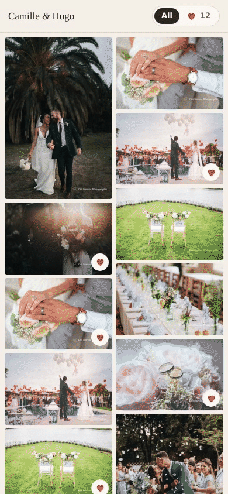
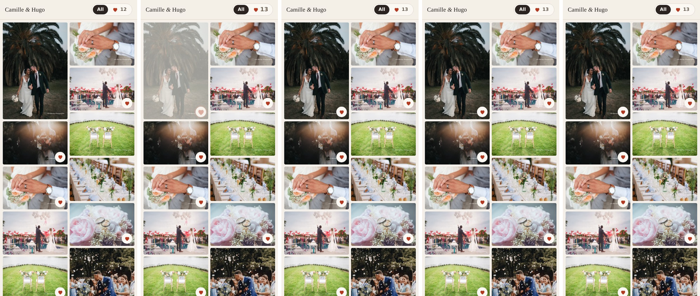

## Viewer

Dark full screen, like the photographer's [viewer](viewer.md).

- **Top bar:** title, "4 of 48", Play / Pause slideshow (advancing every 4 seconds until the last
  photo, pausing on manual navigation, favorite toggles or opening comments), then on desktop the
  **Add to favorites** / **Favorite** button, and ✕.
- **Phone:** the heart button sits under the photo instead of the top bar, easy to reach with a
  thumb.
- **Delivered:** a **Download** button instead of the heart.
- **Comments:** the top-bar button shows the count and toggles a thread, closed by default.
  It sits beside the photo on desktop and below it on phones, never covering the image.
  Escape closes the thread before the viewer; changing photos closes it too. Clients write
  plain text (1–1000 characters), edit client messages, or delete them after confirmation.
  Deleted messages show a placeholder. Replies appear on reopening the thread or reloading,
  without email or live notifications. Delivered galleries and read-only Preview omit comments.
  Short landscape phones use the side panel instead, temporarily hiding the bottom favorite action
  while comments are open to keep the image and composer usable.
