# Dashboard

The photographer's home: what's new, and every gallery as a cover. Route `/dashboard`.

| | Desktop | Phone |
|---|---|---|
| Galleries |  | 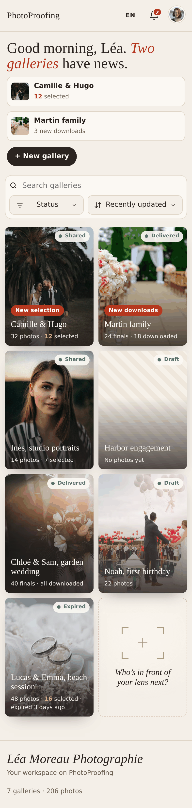 |
| Empty workspace | 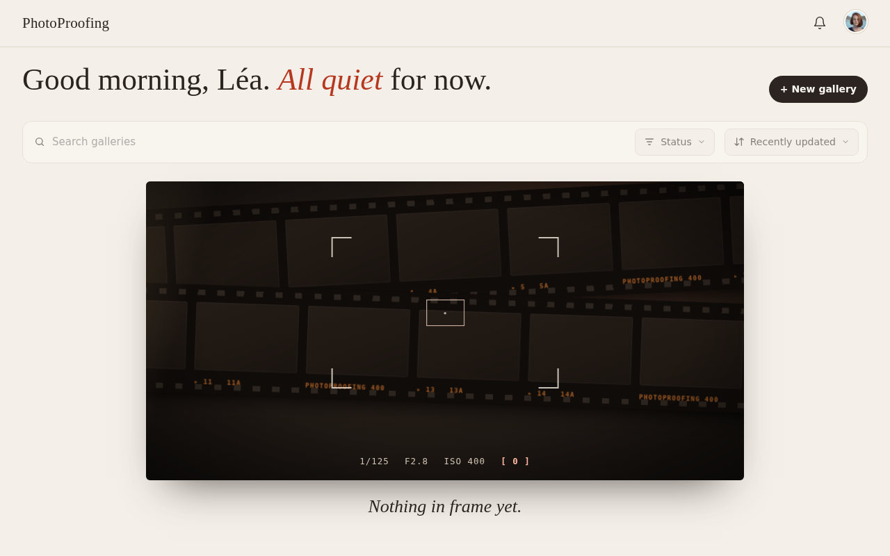 | 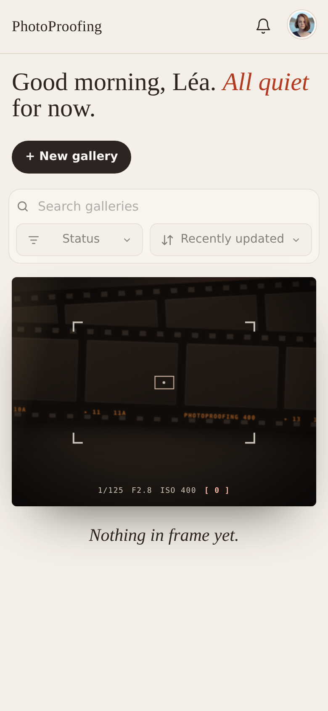 |
| Notifications | 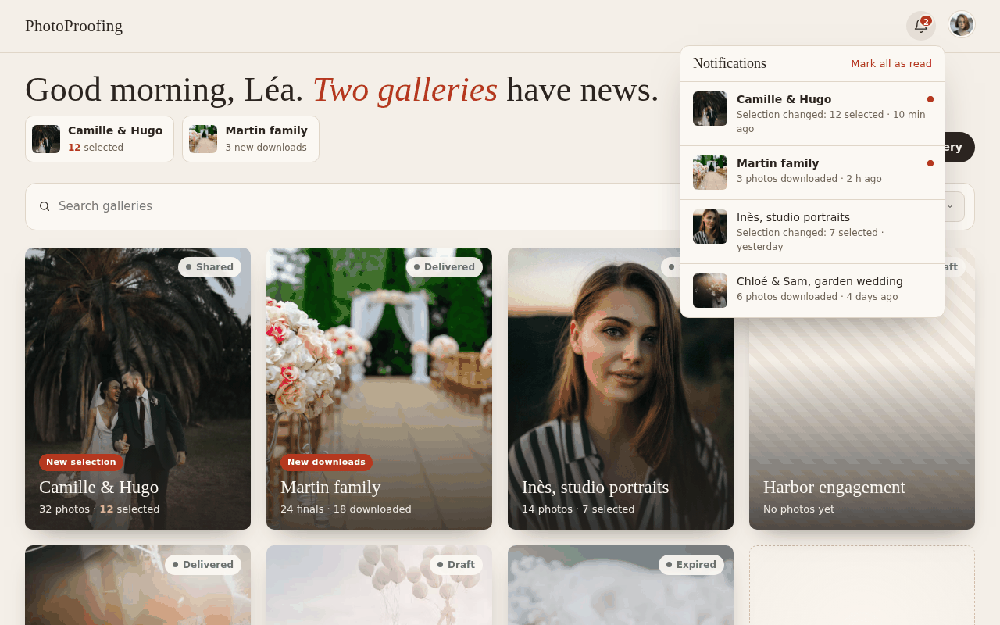 | 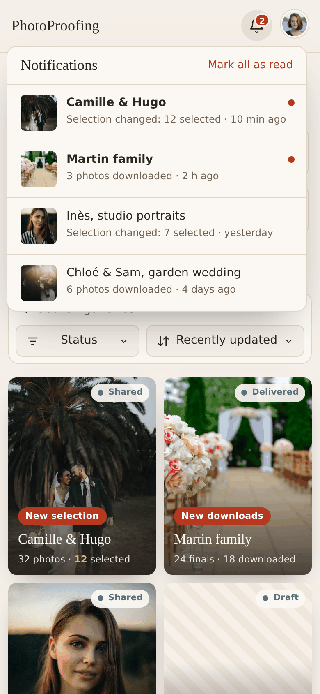 |
| Account menu | 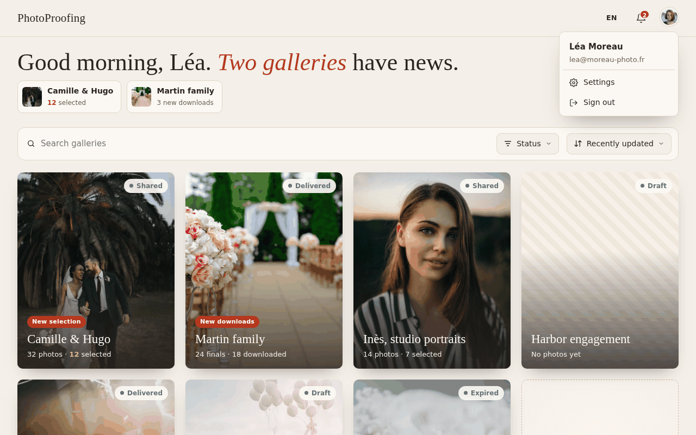 | 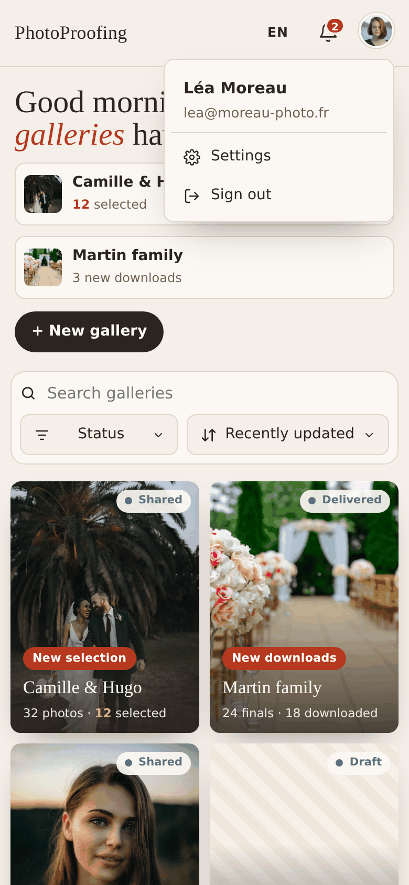 |
| New gallery | 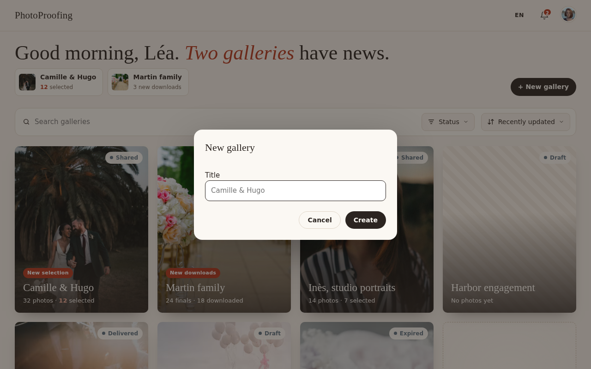 | 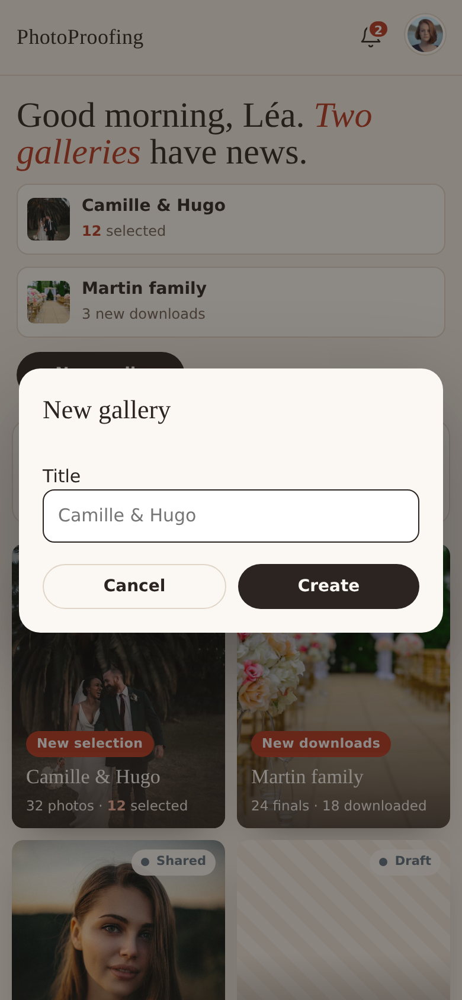 |

## Layout

1. **Top bar:** brand on the left; on the right the **language button** ("EN" or "FR", opening a small menu with English and
   Français; saves at once with the usual toast), the notifications bell (dot when unread) and the
   avatar. See the [languages design](../../2026-11-06-ui-languages-design.md).
2. **Greeting:** a Georgia title that says what needs attention, for example "Good morning, Léa.
   *Two galleries* have news." or "Good morning, Léa. *All quiet* for now." Below it, up to three
   news chips (gallery thumbnail, title, "13 selected" or "4 new downloads"). The **+ New
   gallery** button sits on the right.
3. **Toolbar:** search, Status filter, Sort.
4. **Grid of cover cards**, ending with a "Who's in front of your lens next?" card that also
   creates a gallery.
5. **Footer:** workspace name and totals ("9 galleries · 412 photos").

Search keeps a restrained, visible warm focus outline. The Status trigger has a fixed desktop
width, truncates long summaries, and anchors the menu's right edge to its own right edge, so
toggling statuses never moves the menu.

## Languages

The workspace has one language, English or French, chosen from the top bar. Every screen follows it,
including the client pages. Dates and plurals follow the language too, except the browser's native date input in the prototype. User content (gallery titles,
studio name, file names) is never translated.

| | Desktop | Phone |
|---|---|---|
| Language menu | 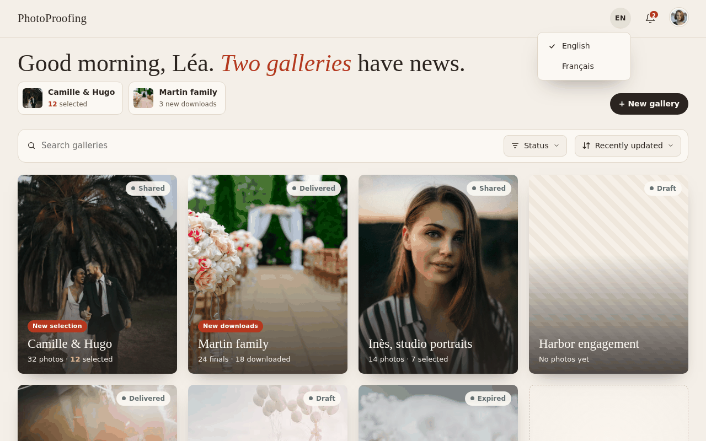 | 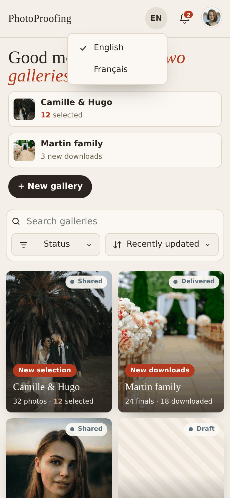 |
| Galleries in French | 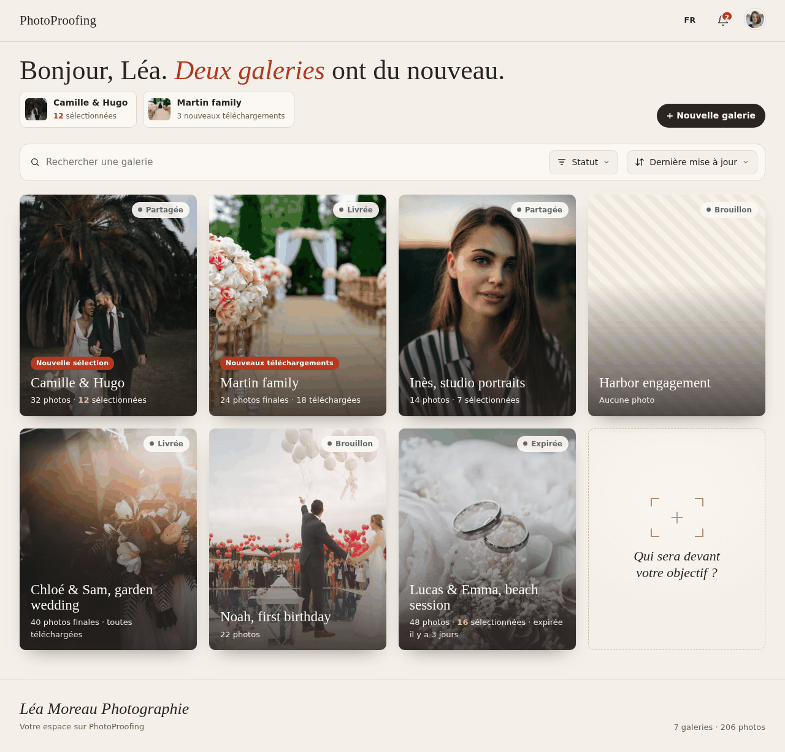 | 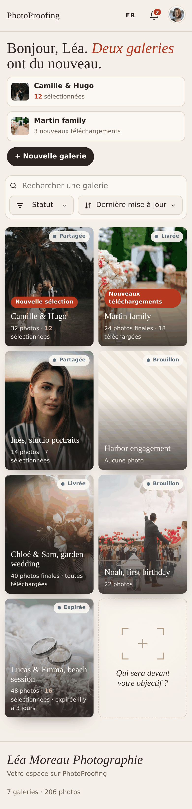 |

## Gallery card

Portrait (4:5) cover of the hero photo with a dark gradient at the bottom:

- status chip at the top left: Draft, Shared, Delivered, Expired or Archived, each with its dot
  colour;
- "New selection" or "New downloads" badge when the gallery has an unread notification;
- title in Georgia, accompanied inline by subtle status icons when applicable: a **Lock** icon when
  protected by a 6-digit access code, and an **EyeOff** icon when client access is closed (`Expired`
  or `Archived`);
- one line that says where it stands:

| Status | Line |
|---|---|
| Draft | "24 photos" or "No photos yet" |
| Shared | "48 photos · 13 selected" (count bold accent when over the allowance) |
| Expired | "48 photos · 13 selected · expired 3 days ago" |
| Delivered | "20 finals · 12 downloaded" or "· all downloaded" |
| Archived | "20 finals · archived" |

No hero: a warm neutral placeholder instead of the photo. Clicking the card opens the gallery.

## Toolbar

- **Search** filters by title as you type and highlights the match.
- **Status** is a multi-select menu with a checkbox, colour dot and count per status, plus
  Select all and Reset. Default: everything except Archived. The button reads "Status" for the
  default, otherwise the chosen names in bold.
- **Sort:** Last updated (default), Newest created, Oldest created, Title A–Z.
- **No results:** "No gallery called “…”" or "No galleries with these statuses", with a hint when
  matches hide in unselected statuses and a **Clear search and status** button.

## Notifications

The bell opens a panel: one row per gallery with unread activity (thumbnail, title, what
happened, how long ago) and a **Mark all as read** link (disabled when nothing is unread).
Clicking a row opens the gallery and marks it read. Opening the panel marks nothing. Empty:
"Nothing new."

## Account menu

The avatar opens a small panel: name and email, then **Settings** and **Sign out**. Both items
use ink text on the panel colour with a light hover, never link blue.

## New gallery

A dialog asking for the title only, then the new gallery opens on its Photos tab.

## Empty workspace

Shown only when there are no galleries. The greeting, **+ New gallery**, search, Status and Sort
stay in place; search and filters are disabled. Below them, a dark contact sheet of empty film
frames with sprocket edges and edge print, seen through viewfinder corner brackets; a camera
readout ("1/125 · F2.8 · ISO 400 · [ 0 ]") and the line "Nothing in frame yet."

Motion: the sheet scrolls very slowly, the focus box breathes, a warm light leak sweeps across.

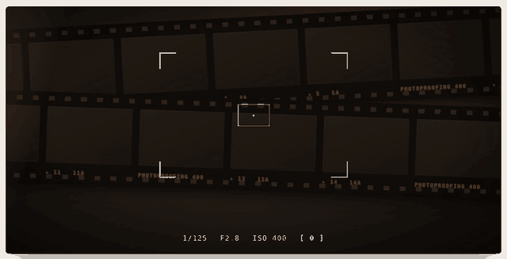
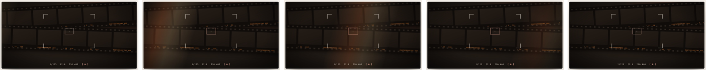
