# Gallery

Where the photographer runs one shoot from upload to delivery. Route `/dashboard/{id}`
(prototype: `#/g/<id>/photos|favorites|final`).

| | Desktop | Phone |
|---|---|---|
| Photos |  | 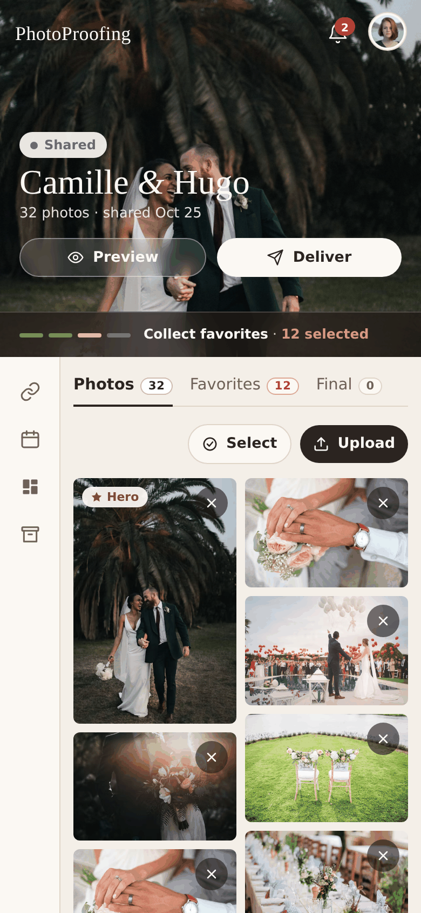 |
| No hero |  |  |
| Uploading | 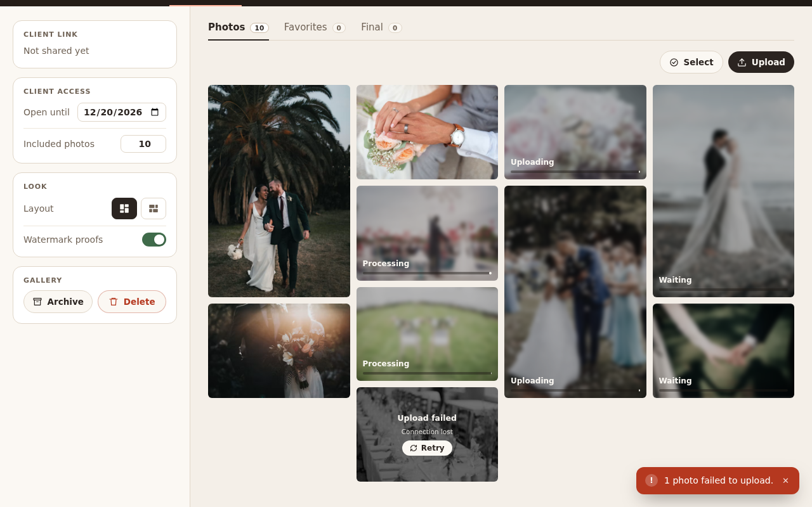 | 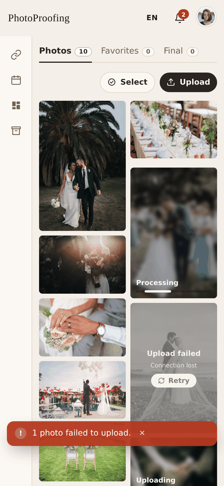 |
| Select |  |  |
| Updating watermarks |  |  |
| Favorites | 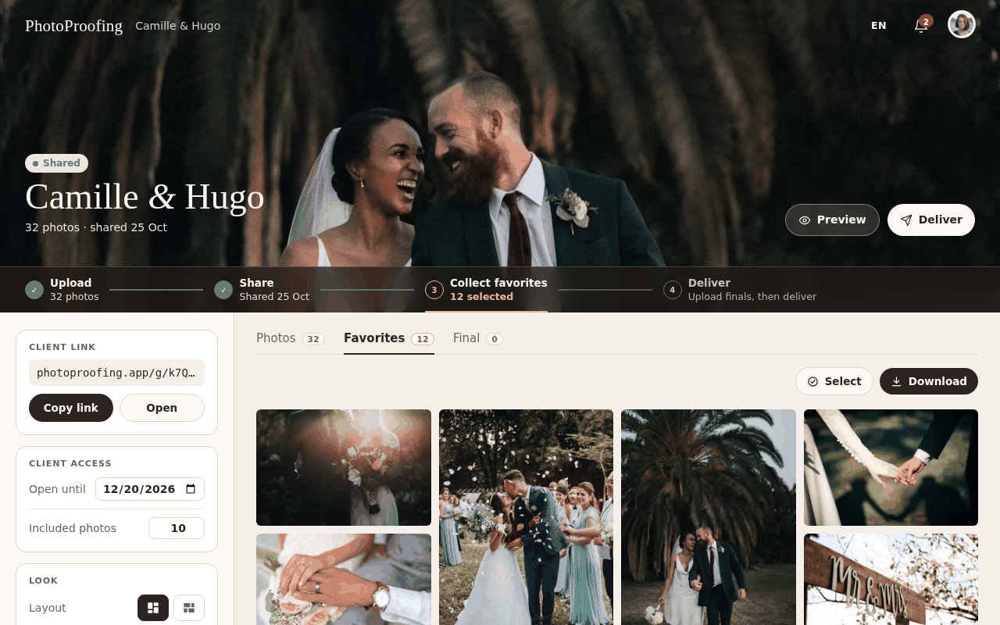 | 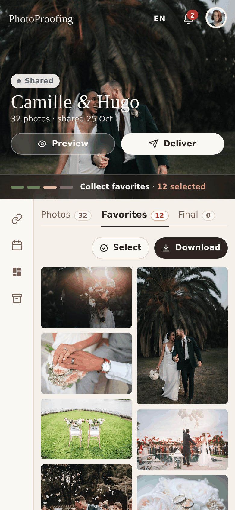 |
| Favorites, select |  |  |
| Final |  | 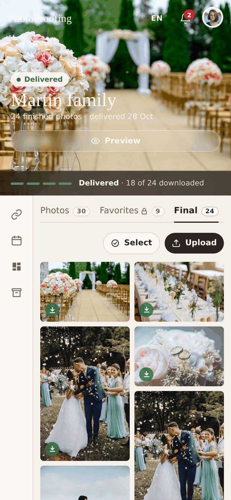 |
| Final, select | 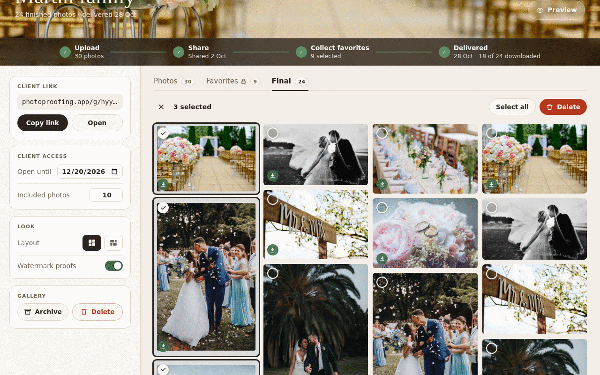 |  |
| Share |  |  |
| Deliver | 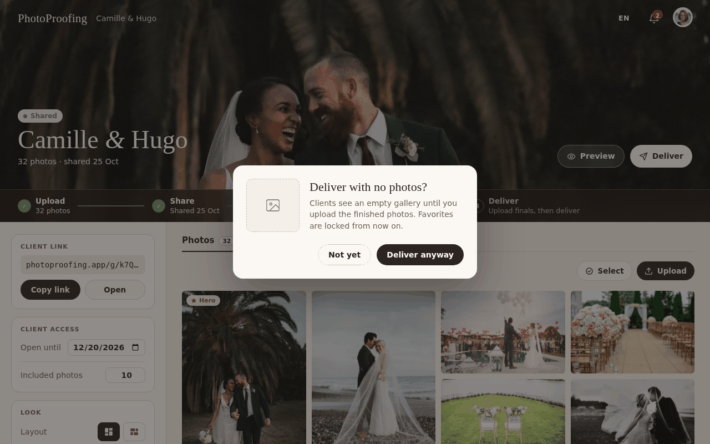 | 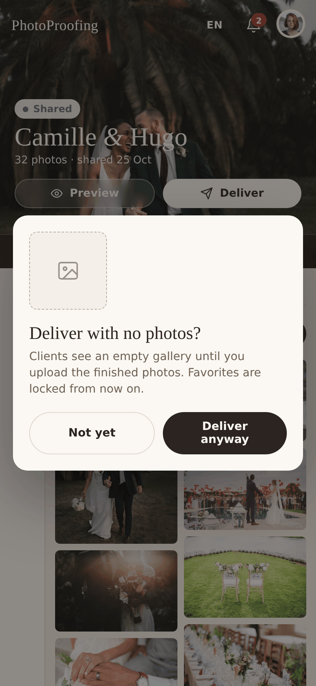 |
| Delete | 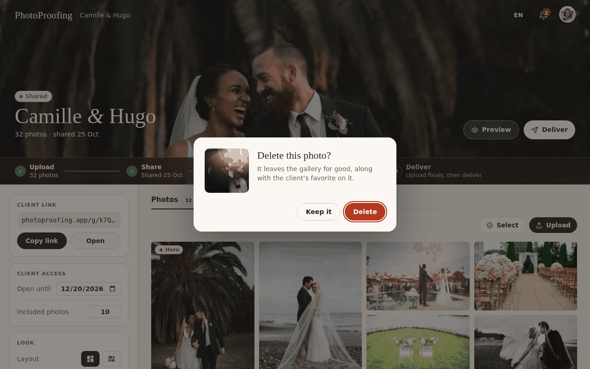 |  |
| Side nav editing |  | |
| Photos in French |  | 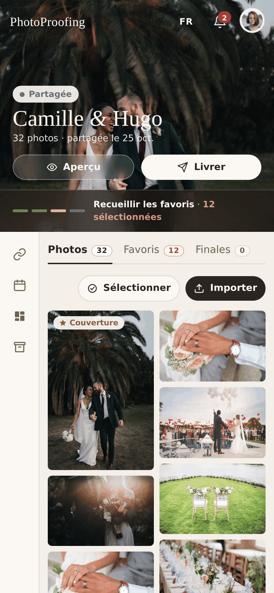 |

## Studio layout: left rail and top journey bar

The gallery page uses the standard top `AppHeader` above a two-column Warm Paper studio workspace on
desktop (`md:`), collapsing to a single-DOM compact stack on `390 px` phones:

- **Left studio rail (`identity` + `nav`):**
  - `← Back to galleries` link and a `3:2` framed cover thumbnail button (`44 × 34 px` on phones)
    showing the hero preview or a compact `CoverBackdrop` stand-in; clicking it opens **Design**.
  - Inline-editable Georgia gallery title paired on its right with a favorite-pin **Star** toggle
    and the read-only status chip (**Draft**, **Prepublish**, **Publish**, **Expired**, **Archived**),
    plus `Shot` (or `Created`) and, once shared, `Last opened` (`Not yet` until first opened).
  - **Collection** navigation with counts: **Photos**, **Favorites** (accented when over allowance,
    padlock once published), **Comments**, **Final**, and **Activity** (`Favorites`, `Comments`, `Final`, and `Activity` stay
    visible and disabled before the first share, with tooltip `"Available once the gallery is shared"`).
  - **Studio** navigation: **Design**, **Share** (disabled with tooltip when archived), **Contacts** (with linked-contact count), and **Settings**.
  - On phones (`< md`), `nav` becomes a horizontally scrollable pill strip below the Journey bar.
- **Top Journey Wizard & action bar (`journey`):**
  - Actionable 4-step wizard on Warm Paper: **Upload → Share → Collect favorites → Publish** (hidden
    when archived; collapses to four progress bars + the active step label and fact on phones).
  - Right-aligned actions: **Preview** (outline) and the stage CTA (**Share** on a draft, opening
    `Studio → Share`; **Publish** during Prepublish; nothing once published; **Restore** when
    archived). While `Studio → Share` is active, the top-right actions swap to **Cancel** (returning
    to the previously active studio section) and **✉ Send invitation (N)**.

## Studio views (`Design`, `Share`, `Contacts`, and `Settings`)

| View / Card | Content |
|---|---|
| **Design** | Compact **Cover** controls (**Select cover** / **Change cover** modal over ready proofs + **Remove cover**, then an interactive rule-of-thirds **Focal point** crosshair pad with `Reset`, disabled without a cover photo, and four visual cover-template mini-cards — **Full bleed**, **Split editorial**, **Framed paper**, **Minimal banner**), **Typography** (four self-hosted heading-font specimen cards — **Editorial**, **Fine Art**, **Timeless**, **Modern** — rendered in their own typefaces), **Photo Grid & Spacing** (**Layout** icon buttons for staggered columns vs even rows, **Grid density** segmented **Compact** / **Large**, and **Spacing** segmented **Compact** / **Generous**) beside a live **Client preview** |
| **Share** | Two centered `660 px` Warm Paper sheets: **Envelope** (**To** pre-populated from linked gallery contacts with inline `email` / `Name <email>` chips + **+ Contacts** workspace directory picker, collapsible **+ BCC** private recipients that are never added to contacts, and editable stage-aware **Subject**) above a **Live Warm Paper Email Preview** (`StudioSignature`, `3:2` hero preview with focal point or `CoverBackdrop` stand-in, Georgia gallery title + shoot-date/photo-count metadata, inline editable personal message `<textarea>`, conditional 6-digit **Access code** monospace callout, stage-aware CTA pill, and optional `Available until {date}` footer). Shows an inline configuration notice when `[smtp]` is unconfigured or when the gallery is expired |
| **Contacts** | Linked contacts list (monogram, **Name**, **Email**, optional **Phone**, **Unlink**), **Manage directory** (`/contacts`), and persistent **+ Link contact** dialog (search all workspace contacts or create and link inline). **Link** briefly becomes **Linked**, then **Unlink** in the same row; clicking **Linked** immediately unlinks too. Only in-flight requests disable the row action |
| **Settings → General** | **Shoot date**, **Open until** (date picker with one-click relative presets from 1 week to 1 year), then **Included photos** (number input, disabled once published), in separate rows; all optional |
| **Settings → Privacy & Protection** | **Client link** (Draft: `"Not shared yet"` + inline **Share link** button opening the direct-link confirmation dialog; once shared: link and **Copy**), **Require access code** (Draft: switch + 6-digit numeric input + **Generate** + **Copy**; once shared: locked read-only 6-digit monospace code + **Copy** when set, or disabled switch noting none can be added after sharing), and **Enable watermarks** switch |
| **Settings → Actions** | **Archive** (or **Restore**) and destructive **Delete**, each with a short consequence hint and confirmation dialog |

- Design and Settings use a one-third controls / two-thirds live [preview](preview.md) split at
  `lg`, without a fixed-height or internally scrolling inline frame, including Phone mode.
  Below `lg` the inline stage is hidden. **Open full preview** expands it on wide screens;
  the gallery content header's **Preview** action remains available at every width.
- Collection and Studio panels stay mounted once opened so counts load on open and in-place edits,
  uploads, invitation drafts, or open viewers survive section switches and autosaves.
- In-place inputs save on change without success rings or repeated `"Saved"` toasts. An invalid
  value shows a red toast and reverts. A past `"Open until"` marks the gallery Expired; a future or
  cleared one lifts it.
- The watermark switch is the only watermark control here. Mark, repeat, position and size live in
  [Settings](settings.md) and apply to every gallery.

## Collection views (`Photos`, `Favorites`, `Comments`, `Final`)

Photos, Favorites and Final use a compact grid of cropped 3:2 tiles. The panel width determines
the number of columns: two below 36 rem, three from 36 rem, and four from 58 rem.

### Photos

The proofs. The toolbar keeps **Upload** visible, even in select mode. Besides the selection
circle, tiles show:

- a star at the top right: **Set as hero** / **Remove hero** (a toggle). On hover and focus only,
  except the hero's own star, which stays visible as a gold star with no text (its tooltip and
  screen-reader label are "Remove hero"). On touch screens use the viewer instead;
- a × to delete, which always asks first.

No hearts or favorite marks here: favorites belong to the Favorites tab. Clicking a photo opens
the [viewer](viewer.md).

**Empty:** a drop zone, "Drop the shoot here", **Upload**. Uploads and failures stay in the grid
beside existing photos; the drop zone only appears when both are empty.

**Upload:** each new tile goes Waiting → Uploading → Processing → ready, each with a label and an
indeterminate bar (no percentages, no overall counter). The status stays centered inside its
tile, above the bottom progress bar. A failed tile turns red, "Upload failed"
with the reason, a **Retry** button and ×; a red toast says "1 photo failed to upload."

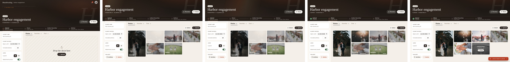

**Updating watermarks:** after watermark settings change, all galleries show a slim
"Updating watermarks…" line with a small spinner in the toolbar until the marked proofs are
regenerated, even with watermarking off. Clean owner tiles, the open viewer and the hero remain
usable and unwatermarked. Unlike initial upload processing, regeneration keeps the photo visible
with a small bottom status badge; a failed regeneration includes **Retry**. Published render
revisions refresh client images without reloading the gallery; originals and finals stay
unwatermarked. Switching watermarking on or off only selects existing files.

### Favorites

Only the client's selection, read-only. The toolbar offers **Download all** when there are any
favorites. Hovering a photo shows a small download button
for that photo (always visible on touch). The empty state has a heart and "No favorites yet".
Opening a photo
shows the viewer with the favorite heart and the same individual-original download action.
The whole or selected subset uses one ZIP preparation slot: **Downloading…** is disabled from
the initial request until download initiation, with errors left visible and no separate success
message. If a ZIP status check fails, **Retry ZIP status** checks the same request without
starting a new one. If the requested ZIP is no longer available, the photographer can use
**Download** to request it again. Select-mode subsets always use a ZIP, even for one selected
photo; tile and viewer downloads stream the individual original with a busy download control.
Individual download errors appear separately from ZIP errors.

### Final

The finished photos, private to the photographer until delivered. The toolbar offers **Upload**
and, when at least one Final is ready, **Download all** for a ZIP of ready originals. The
selection bar offers **Download X** for the exact selected set; if any selected photo is not
ready, it explains why the ZIP is unavailable and still allows Delete. Owner ZIPs require an
authenticated session and are independent of client delivery: they do not deliver the gallery,
change client selection, or record client downloads. When the client has downloaded a Final,
the owner can see the timestamp in the viewer, not on the tile.
As with Favorites, **Retry ZIP status** resumes a failed status check without starting a new ZIP
or substituting a newer archive.

Use × to delete a photo, or the "Drop the finished photos here" zone to start an empty Final grid.

### Select mode

Start by pressing the 26 px circle at a tile's top left. It appears on hover or keyboard focus,
and is always visible on touch and while selecting. In select mode, the tile body toggles
selection instead of opening the viewer. The normal toolbar and tile positions stay put.

A floating bar shows **Exit selection**, the count and **Select all** (or **Unselect all**).
Photos offers **Delete**, Favorites **Download**, and Final both. These actions are disabled at
zero, but select mode stays open until exited with **✕** or Escape. Below 80 rem, gallery
actions use icons with accessible names and can wrap to fit clear of the rails.
Select all picks only photos currently shown in that tab and
does not include local queue items.

Confirming a photo deletion shows a disabled **Deleting…** button with a spinner and retains
the confirmed count.
Cancel and Escape cannot dismiss it while deletion runs; removed tiles shrink and fade unless
reduced motion is requested. Desktop journey steps are centered within the banner.

## Dialogs

Share, Deliver and Delete always confirm. Share and Deliver never refuse: when nothing is ready
they warn and the button says "anyway". The "until 12 Sep" in the Share text only appears when
an Open until date is set.

Deliver counts and warns about finals only; proofs do not contribute to that dialog.

| Dialog | Normal | Something missing |
|---|---|---|
| Share | "Share 48 photos?" "This creates a private link. Anyone with it can see the proofs and pick favorites until 12 Sep." **Cancel** / **Share** | "Share with no photos?" warning "Clients see an empty gallery until you upload." **Share anyway** |
| Deliver | "Deliver 20 photos?" "Camille & Hugo see them at the same link and can download them. Favorites are locked from now on." **Cancel** / **Deliver** | "Deliver with no photos?" **Deliver anyway** |
| Delete photos | Stack of the photos, count; mentions client favorites only if one is a favorite | — |

Photos still uploading or failed are mentioned as a warning line ("2 are still uploading and 1
failed."). After **Settings → Privacy & Protection → Share link**, the photo stack flies out, a green
check pops and the dialog becomes "Your gallery is shared" with **Copy link**. Email invitations
live in **Studio → Share** when `[smtp]` is configured; SMS remains future scope.

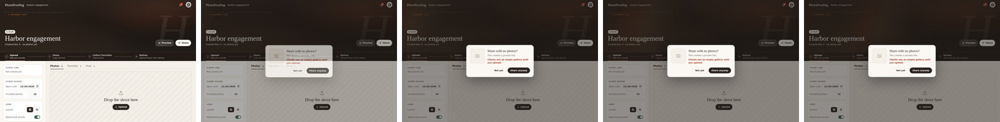
