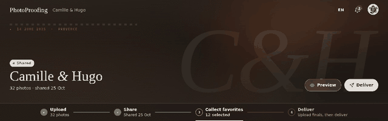
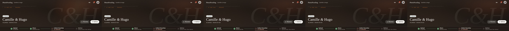

# Gallery

Where the photographer runs one shoot from upload to delivery. Route `/dashboard/{id}`
(prototype: `#/g/<id>/photos|favorites|final`).

| | Desktop | Phone |
|---|---|---|
| Photos |  |  |
| No hero |  |  |
| Uploading |  |  |
| Select |  |  |
| Updating watermarks |  |  |
| Favorites |  |  |
| Favorites, select |  |  |
| Final |  |  |
| Final, select |  |  |
| Share |  |  |
| Deliver |  |  |
| Delete |  |  |
| Side nav editing |  | |
| Photos in French |  |  |

## Header: hero and journey

The hero photo fills a wide banner. Over it:

- status chip (Draft, Shared, Delivered, Expired, Archived), title in Georgia, one meta line
  ("48 photos · shared 12 Jun");
- **Preview** (ghost) and the next main action: **Share** for a draft, **Deliver** once shared,
  nothing once delivered, **Restore** when archived;
- the **journey steps**, centred along the bottom: Upload → Share → Collect favorites → Deliver. Done steps
  show a green tick and a fact ("Shared 12 Jun", "13 selected"), the current step is highlighted,
  later ones are dim. On phones the steps collapse to four dots and the current step's label.
  Hidden when archived.

**No hero:** a warm dark gradient with the gallery's initials large and faint, a film-edge line
with the date and place, and a slow light leak. Title, chip, meta, actions and steps sit on it
as usual, so it looks intended, not missing.

## Side nav

Four cards on the left; on phones an icon rail whose buttons pop the same cards out.

| Card | Content |
|---|---|
| Client link | Draft: "Not shared yet". Shared: the link and **Copy link**; the owner uses read-only **Preview**, not the client credential |
| Client access | **Open until** (date input) and **Included photos** (number input), edited in place; both optional, empty means no expiry or no limit |
| Look | **Layout** as two icon buttons (staggered columns, even rows; even rows by default) and a **Watermark proofs** switch |
| Gallery | **Archive** or **Restore**, **Delete** |

- In-place inputs save on change without success rings or repeated "Saved" toasts. Pending saves
  show **Saving…**; loaded photos and the viewer stay mounted. An invalid value shows
  a red toast and reverts. A past "Open until" makes the gallery Expired; a future or cleared one lifts it. The prototype
  seeds every gallery with a date, a count and staggered columns and refuses empty values; build
  to this doc and the PRD instead.
- The prototype's date input follows the browser's locale; the real app must format it in the workspace language.
- The watermark switch is the only watermark control here. Mark, repeat, position and size live in
  [Settings](settings.md) and apply to every gallery.
- Archive asks first ("Archive this gallery?", "The client link stops working. You can restore it
  any time."). Delete asks with the danger style ("Delete this gallery?", "Its photos, favorites
  and client link go for good.", **Keep it** / **Delete**).

## Tabs

**Photos**, **Favorites** and **Final**, each with its count. The Favorites count turns bold
accent when over the allowance. After delivery Favorites shows a padlock: the selection is locked.
Before the first share, **Favorites** and **Final** are dimmed and disabled, with
the tooltip "Available once the gallery is shared". Only Photos opens, even from
a direct link; pointer and keyboard navigation skip the disabled tabs. Sharing
enables both immediately without reloading or discarding existing photos.

### Photos

The proofs. Toolbar: **Select** and **Upload**. Tiles show only:

- a star at the top right: **Set as hero** / **Remove hero** (a toggle). On hover and focus only,
  except the hero's own star, which stays visible as a gold star with no text (its tooltip and
  screen-reader label are "Remove hero"). On touch screens use the viewer instead;
- a × to delete, which always asks first.

No hearts or favorite marks here: favorites belong to the Favorites tab. Clicking a photo opens
the [viewer](viewer.md).

**Empty:** a drop zone, "Drop the shoot here", **Upload**.

**Upload:** each new tile goes Waiting → Uploading → Processing → ready, each with a label and an
indeterminate bar (no percentages, no overall counter). The status stays centered inside its
tile, above the bottom progress bar. A failed tile turns red, "Upload failed"
with the reason, a **Retry** button and ×; a red toast says "1 photo failed to upload."

**Updating watermarks:** after watermark settings change, galleries with watermarking on show a
slim "Updating watermarks…" line with a small spinner in the toolbar until the proofs are
regenerated. Published render revisions refresh tiles, the open viewer and the hero without
reloading the gallery; originals and finals stay unwatermarked.

### Favorites

Only the client's selection, read-only. Toolbar: **Select** and **Download** (the whole selection
as a ZIP, with a busy state while it's prepared). Hovering a photo shows a small download button
for that photo (always visible on touch). Empty: the same striped drop-area look as the other
empty tabs, with a heart and "No favorites yet". Opening a photo
shows the viewer with the favorite heart and the same individual-original download action.
The whole or selected subset uses one ZIP preparation slot: **Downloading…** is disabled from
the initial request until download initiation, with errors left visible and no separate success
message. Select-mode subsets always use a ZIP, even for one selected photo;
tile and viewer downloads stream the individual original with a busy download control.

### Final

The finished photos, private until delivered. Same toolbar as Photos (**Select**, **Upload**),
× to delete, drop zone "Drop the finished photos here" when empty. After delivery, a small
download mark shows which photos the client has downloaded.

### Select mode

**Select** keeps the warm toolbar where it is, with no dark bar. On the left appear ✕ and
"3 selected"; on the right **Select** becomes **Select all**, and the main button becomes
**Delete** on Photos and Final or **Download** on Favorites. Tiles show a check; clicking toggles.
Select all only picks the current tab.

All three tabs use the same striped empty-state background. Confirming a photo deletion shows
a disabled **Deleting…** button with a spinner and retains the confirmed count.
Cancel and Escape cannot dismiss it while deletion runs; removed tiles shrink and fade unless
reduced motion is requested. Desktop journey steps are centered within the banner.

## Dialogs

Share, Deliver and Delete always confirm. Share and Deliver never refuse: when nothing is ready
they warn and the button says "anyway". The "until 12 Sep" in the Share text only appears when
an Open until date is set.

Deliver counts and warns about finals only; proofs do not contribute to that dialog.

| Dialog | Normal | Something missing |
|---|---|---|
| Share | "Share 48 photos?" "This creates a private link. Anyone with it can see the proofs and pick favorites until 12 Sep." **Not yet** / **Share** | "Share with no photos?" warning "Clients see an empty gallery until you upload." **Share anyway** |
| Deliver | "Deliver 20 photos?" "Camille & Hugo see them at the same link and can download them. Favorites are locked from now on." **Not yet** / **Deliver** | "Deliver with no photos?" **Deliver anyway** |
| Delete photos | Stack of the photos, count; mentions client favorites only if one is a favorite | — |

Photos still uploading or failed are mentioned as a warning line ("2 are still uploading and 1
failed."). After Share the photo stack flies out, a green check pops and the dialog becomes "Your
gallery is shared" with **Copy link**. The prototype also shows Email and SMS; those are future
scope, not MVP.

