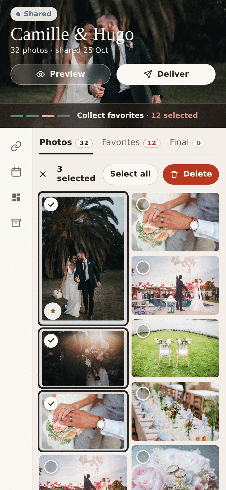
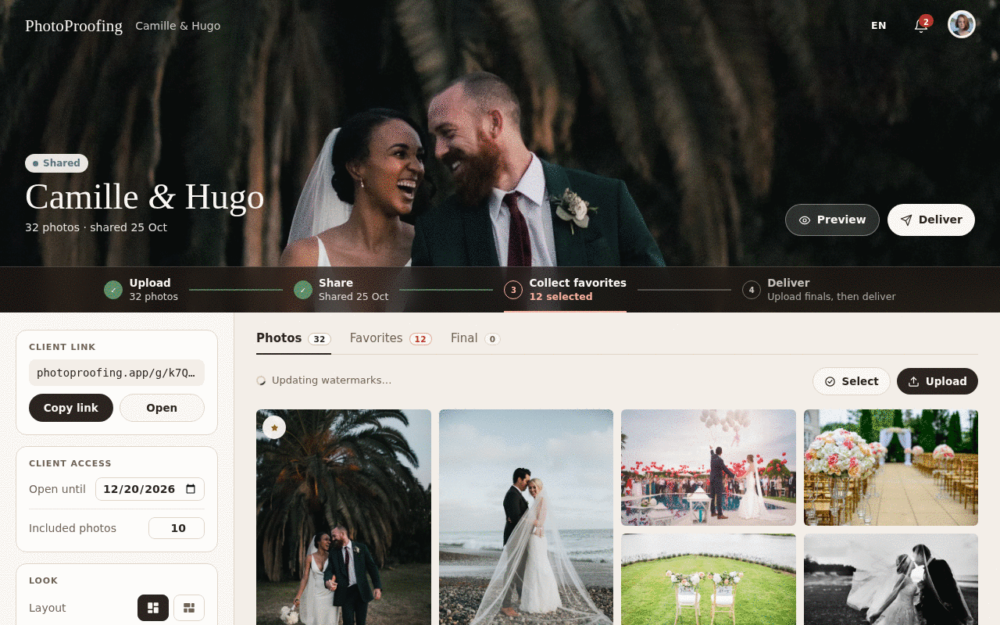
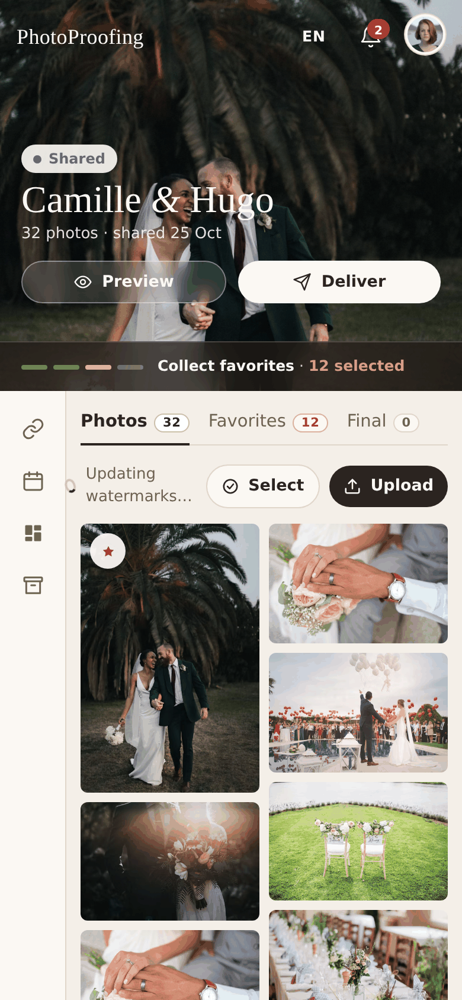
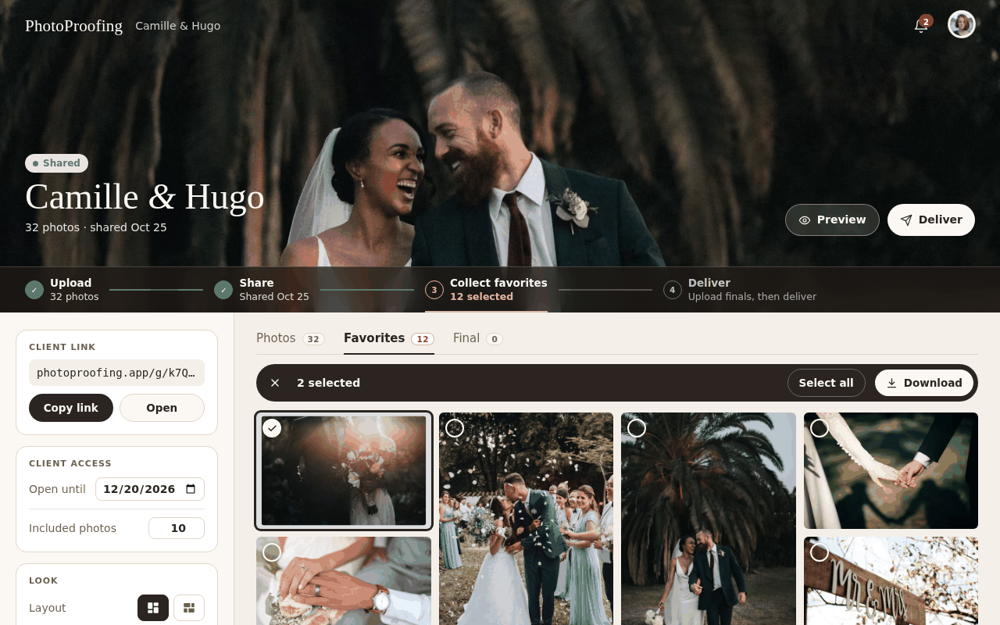
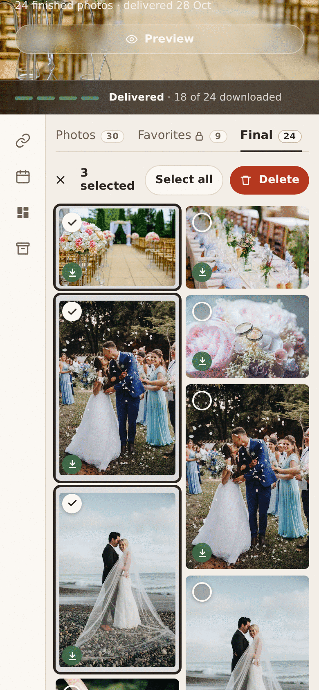
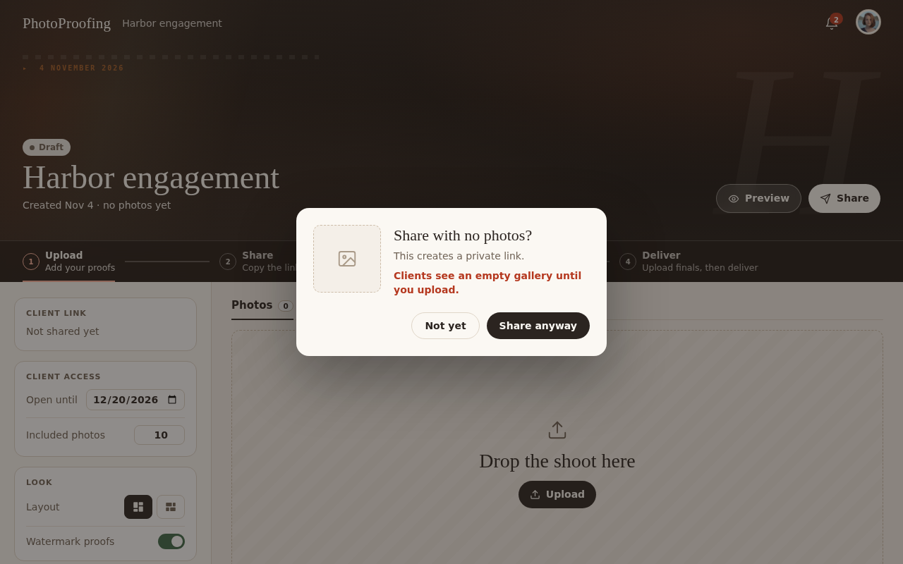
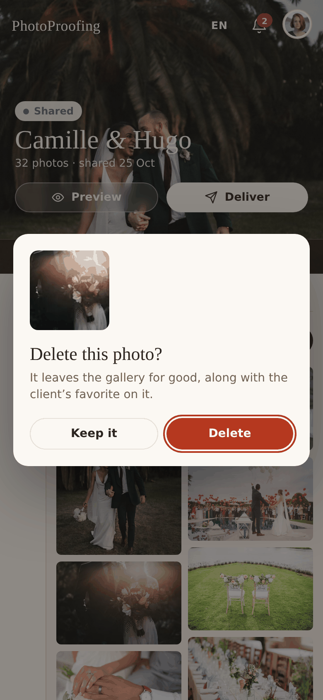
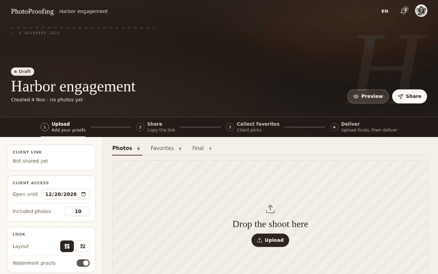

# Gallery

Where the photographer runs one shoot from upload to delivery. Route `/dashboard/{id}`
(prototype: `#/g/<id>/photos|favorites|final`).

The collection and dialog images below are historical prototype references, not the current
Studio layout.

|                           | Desktop                                     | Phone                                     |
| ------------------------- | ------------------------------------------- | ----------------------------------------- |
| Photos                    |              |              |
| No hero                   |             |             |
| Uploading                 |              |              |
| Select                    |              |              |
| Updating watermarks       |  |  |
| Favorites                 |           |           |
| Favorites, select         |    |    |
| Final                     |               |               |
| Final, select             |        |        |
| Direct Share confirmation |       |       |
| Publish confirmation      |     |     |
| Delete                    |      |      |
| Side nav editing          |       |                                           |
| Photos in French          |           |           |

## Studio layout: left rail and top journey bar

The gallery page uses the standard top `AppHeader` above a two-column Warm Paper studio workspace on
desktop (`md:`), collapsing to a single-DOM compact stack on `390 px` phones:

- **Left studio rail (`identity` + `nav`):**
  - The desktop rail stays visible across stages and matches the workspace sidebar: `16vw`,
    clamped to `240–280 px`.
  - A framed cover thumbnail button shows the hero or a `CoverBackdrop` stand-in; clicking it
    opens **Design**. The shared dotless status chip sits at the bottom-left with the gallery
    favorite chip immediately beside it; the star stays gold in active and inactive states.
  - The inline-editable gallery title is below the cover. Optional shoot date, expiry and
    `Last opened` metadata stay as separate lines below the title, never on the cover.
  - **Collection** navigation with counts: **Photos**, **Favorites** (accented when over allowance,
    no owner padlock after publication), **Comments**, and **Final**. Favorites, Comments, Final and Studio
    Activity remain visible but disabled before the first share.
  - **Studio** navigation: **Design**, **Activity**, **Comments**, **Contacts** (with linked-contact
    count), and **Settings**.
  - On phones (`< md`), `nav` becomes a horizontally scrollable pill strip below the Journey bar.
- **Top Journey bar (`journey`):**
  - **Upload → Share → Collect favorites → Import finished photos → Deliver photos** remain
    visible at every phone width. Upload opens Photos, Share opens the existing share action,
    Collect opens Favorites, Import opens Final and Deliver opens the existing delivery action.
  - Collect remains current until an explicit **Download all** finishes successfully. The exact
    downloaded favorite IDs are stored in browser-local convenience state and compared with the
    currently loaded favorite set. Subset downloads never complete Collect, and a later client
    favorite change returns Collect to the current step.
  - Contextual actions stay in their panels: Upload in Photos/Final, Download all in Favorites,
    Open full preview in Design and New contact in Contacts. The header contains only Journey
    progress. When archived, **Restore** replaces it.

## Studio views (`Design`, `Share`, `Contacts`, and `Settings`)

| View / Card                         | Content                                                                                                                                                                                                                                                                                                                                                                                                                                                                                                                                                                                                      |
| ----------------------------------- | ------------------------------------------------------------------------------------------------------------------------------------------------------------------------------------------------------------------------------------------------------------------------------------------------------------------------------------------------------------------------------------------------------------------------------------------------------------------------------------------------------------------------------------------------------------------------------------------------------------ |
| **Design**                          | **Cover** combines a live image and focal-point crosshair. Drag to reposition, releasing to save, or use arrow keys (Shift for larger increments). The **Select cover** / **Change** picker shows ready proofs. When a cover exists, **Change** and **Remove** are equal full-width buttons and both include icons; **Remove** clears the cover. **Style**, **Typography** font specimens, and **Photo Grid & Spacing** remain beside the live client preview. **Open full preview** lives inside Design and opens the full client preview at every width; both preview variants are inert and visual-only   |
| **Share**                           | A wide Warm Paper sheet with the **Invitation envelope** on the left and a read-only **Live email preview** on the right, stacked on phones. Only the envelope edits **To** (linked contacts, typed addresses, or the directory), optional private **BCC**, **Subject**, and **Personal message**. Preview shows stage-specific copy, the cover, metadata, access-code callout if enabled, and expiry; it never includes recipients. Proof readiness, missing SMTP and expiry are explained inline. **Publish** is a separate confirmed delivery action inside Share; **Send invitation** is always explicit |
| **Contacts**                        | Full workspace directory with the same search, sort and contact rows as `/contacts`. Each row shows **Linked** or **Not linked**, can be edited in place, and toggles association without leaving the gallery. Selection offers **Quick edit**, **Link selected** and **Unlink selected**; global contact deletion remains on `/contacts`. The local **New contact** action creates and links in one explicit action. Any further redesign remains a separate design.                                                                                                                                        |
| **Settings → General**              | **Shoot date**, **Open until** (date picker with one-click relative presets from 1 week to 1 year), then **Included photos** (number input, disabled once published), in separate rows; all optional                                                                                                                                                                                                                                                                                                                                                                                                         |
| **Settings → Privacy & Protection** | **Client link** (Draft: `"Not shared yet"` + inline **Share link** button opening the direct-link confirmation dialog; once shared: link and a fixed-width **Copy** button with icon, green confirmation and toast), **Require access code** (Draft: switch + 6-digit numeric input + **Generate** + **Copy**; once shared: locked read-only 6-digit monospace code + **Copy** when set, or disabled switch with the explanation below the label), and **Enable watermarks** switch                                                                                                                          |
| **Settings → Actions**              | **Archive** (or **Restore**) and destructive **Delete**, each with a short consequence hint and confirmation dialog                                                                                                                                                                                                                                                                                                                                                                                                                                                                                          |

- Design, Contacts and Settings do not repeat their tab name as a panel heading. Each panel starts
  with its first real section or action. Settings cards stretch across the full available panel.
- Design uses a one-third controls / two-thirds live [preview](preview.md) split at
  `lg`, without a fixed-height or internally scrolling inline frame, including Phone mode.
  Below `lg` the inline stage is hidden; Design’s **Open full preview** still opens the full dialog.
  Density and spacing controls keep each pill row on one line down to phone widths.
- Collection and Studio panels stay mounted once opened so counts load on open and in-place edits,
  uploads, invitation drafts, or open viewers survive section switches and autosaves in the same
  gallery. Switching galleries starts a new editor and dismisses any open confirmations.
- **Open full preview** is a primary black action inside Design, not an outlined header control.
- Focal-point edits update the preview immediately; saves complete in order. If the latest save
  fails, the preview returns to the last saved point. Leaving the gallery still sends released
  saves to their original gallery but discards a drag that has not been released. If saves were
  still pending when you left, the focal control waits for the confirmed point when you return.
- In-place inputs save on change without success rings or repeated `"Saved"` toasts. An invalid
  value shows a red toast and reverts. A past `"Open until"` marks the gallery Expired; a future or
  cleared one lifts it.
- The watermark switch is the only watermark control here. Mark, repeat, position and size live in
  [Settings](settings.md) and apply to every gallery.

## Collection views (`Photos`, `Favorites`, `Comments`, `Final`)

Photos, Favorites and Final use a compact grid of cropped 3:2 tiles. The panel width determines
the number of columns: two below 36 rem, three from 36 rem, and four from 58 rem.

### Photos

The proofs. The toolbar keeps **Upload** visible, even in select mode. Delete is available only in the selection bar and requires confirmation. Cancelling leaves the photos in place.

No hearts or favorite marks here: favorites belong to the Favorites tab. Clicking a photo opens
the [viewer](viewer.md).

**Empty:** a drop zone, "Drop the shoot here", **Upload**. Uploads and failures stay in the grid
beside existing photos; the drop zone only appears when both are empty.

**Upload:** each new tile goes Waiting → Uploading → Processing → ready, each with a label and an
indeterminate bar (no percentages, no overall counter). The status stays centered inside its
tile, above the bottom progress bar. A failed tile turns red, "Upload failed"
with the reason, a **Retry** button and ×; a red toast says "1 photo failed to upload."

**Updating watermarks:** after watermark settings change, all galleries show a slim
"Updating watermarks…" line with a small spinner in the toolbar until the marked proofs are
regenerated, even with watermarking off. Clean owner tiles, the open viewer and the hero remain
usable and unwatermarked. Unlike initial upload processing, regeneration keeps the photo visible
with a small bottom status badge; a failed regeneration includes **Retry**. Published render
revisions refresh client images without reloading the gallery; originals and finals stay
unwatermarked. Switching watermarking on or off only selects existing files.

### Favorites

Only the client's favorites, most recent first and read-only. Whenever favorites exist, the panel toolbar offers **Download all**, including while a subset is checked. **Download selected** in the selection bar exports only the checked originals, even just one. Neither tiles nor the favorite viewer offer an individual download. The viewer keeps the read-only favorite heart and comments. The empty state has a heart and "No favorites yet".
In Full image, favorite dates use the shared dark glass caption. In Print, only the date moves
below the photo; the heart stays in the full-image treatment.

Both actions share the same ZIP preparation slot and are disabled while a download is preparing.
The initial tab render never checks for an old ZIP. Once Download is pressed, export state and
failures are reported without a permanent status panel; pressing Download again retries.

### Final

Finished photos are private until delivered. The photographer can upload and manage them, but the tab offers no download action. A passive mark and the first request date appear only on requested tiles, not in the viewer. The count is distinct current photos requested, not clicks or confirmed saves.

Use the selection bar and confirm to delete photos, or the "Drop the finished photos here" zone to start an empty Final grid.

### Comments

The tab lists commented proof photos without a search control. Opening one conversation shows
the photographer's replies and names a client when the comment came through a personal link;
general-link and historical comments remain anonymous. The server, not the viewer, decides which
comments the current author can edit or delete.

### Select mode

Start by pressing the 26 px circle at a tile's top left. It appears on hover or keyboard focus,
and is always visible on touch and while selecting. In select mode, the tile body toggles
selection instead of opening the viewer. The normal toolbar and tile positions stay put.

A floating bar shows **Exit selection**, the count and **Select all** (or **Unselect all**).
Photos and Final offer **Delete**, Favorites **Download selected**. These actions are disabled at
zero, but select mode stays open until exited with **✕** or Escape. Below 80 rem, gallery
actions use icons with accessible names and can wrap to fit clear of the rails.
Select all picks only photos currently shown in that tab and
does not include local queue items.

Confirming a photo deletion shows a disabled **Deleting…** button with a spinner and retains
the confirmed count.
Cancel and Escape cannot dismiss it while deletion runs; removed tiles shrink and fade unless
reduced motion is requested. Desktop journey steps are centered within the banner.

## Dialogs

Direct Share, Publish and Delete confirm. Direct Share and Publish never refuse: when nothing is ready
they warn but leave the action available. The "until 12 Sep" in the Share text only appears when
an Open until date is set.

Publish counts and warns about finals only; proofs do not contribute to that dialog.

| Dialog        | Normal                                                                                                                                                | Something missing                               |
| ------------- | ----------------------------------------------------------------------------------------------------------------------------------------------------- | ----------------------------------------------- |
| Share         | Photo count, gallery name and client link access, including expiry if set. **Cancel** / **Customize** / **Share**                                     | Warn when there are no ready photos.            |
| Deliver       | Final photo count, gallery name and one sentence: the client will find the finished photos at the same link. **Cancel** / **Customize** / **Deliver** | Warn that nothing is available to download yet. |
| Delete photos | Stack of the photos, count; mentions client favorites only if one is a favorite                                                                       | —                                               |

Send an email starts checked when sending is available and the gallery has a recipient.
Unchecking it disables Customize without preventing sharing or delivery.

Photos still uploading or failed are mentioned as a warning line ("2 are still uploading and 1
failed."). After **Settings → Privacy & Protection → Share link**, the photo stack flies out, a green
check pops and the dialog becomes "Your gallery is shared" with **Copy link**. Email invitations
live in **Studio → Share** when `[smtp]` is configured; SMS remains future scope. Confirming
**Publish** switches the existing client link from proofs to finals and updates the invitation
preview. It never sends email; use **Send invitation** separately if needed.
**Send invitation** keeps the selected recipients and copy through the photo-readiness check and
any **Send anyway** confirmation. If protection changes or its save fails after starting either
**Share link** or **Send invitation**, start the action again.

