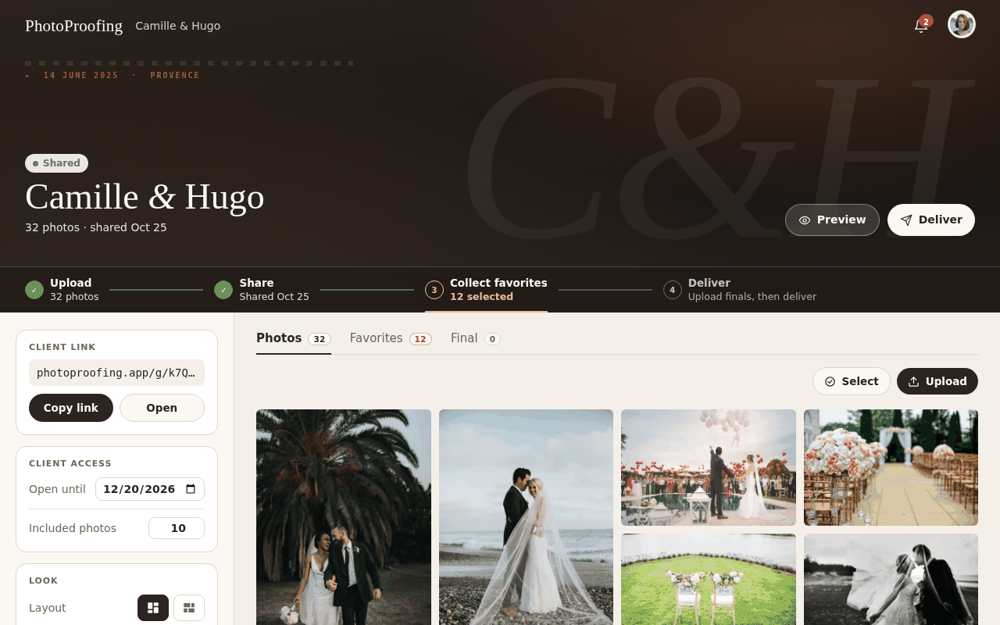
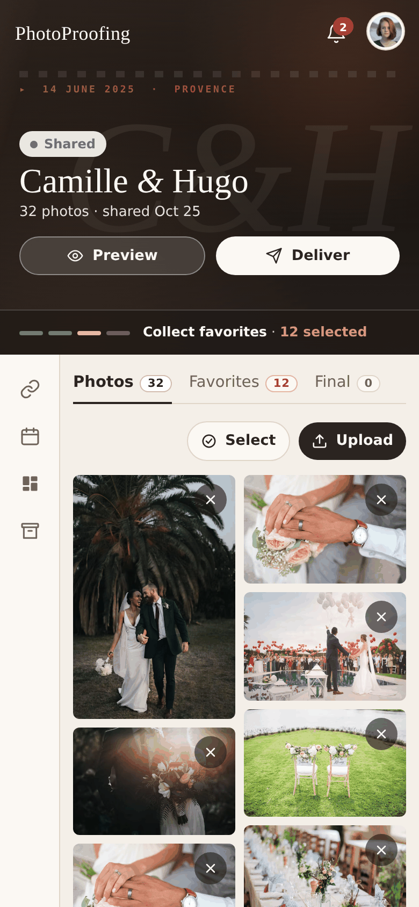
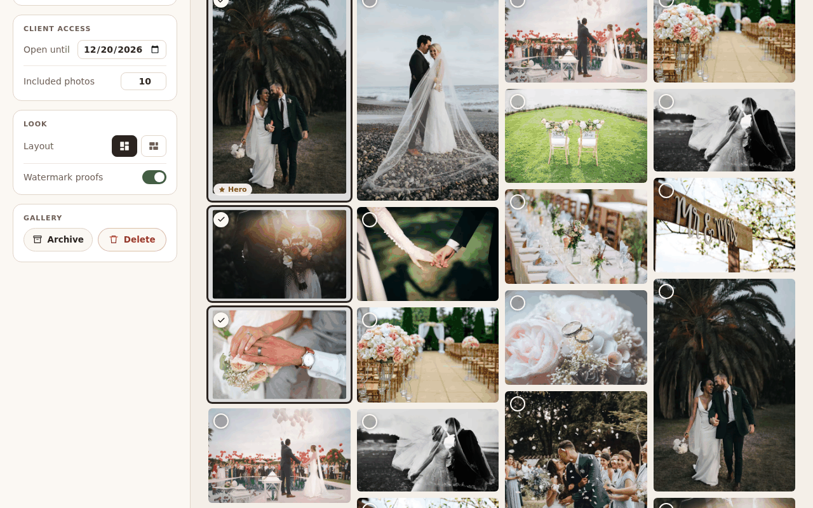
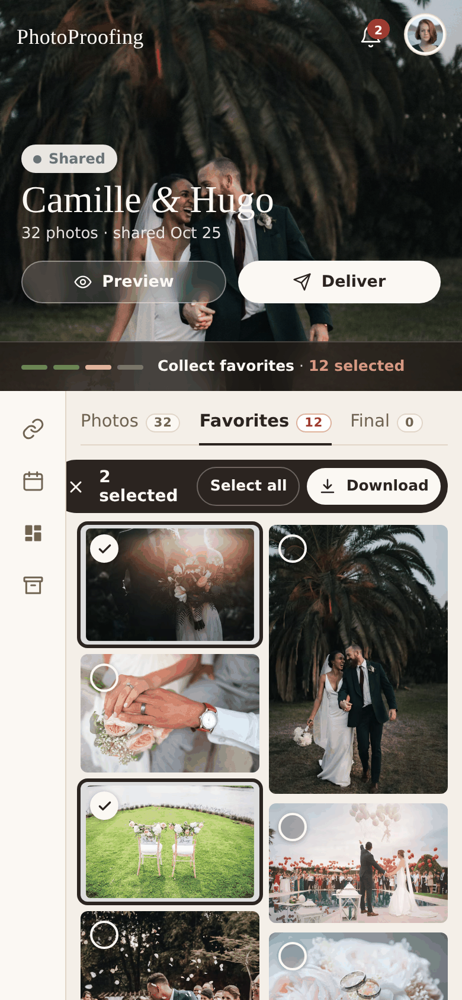
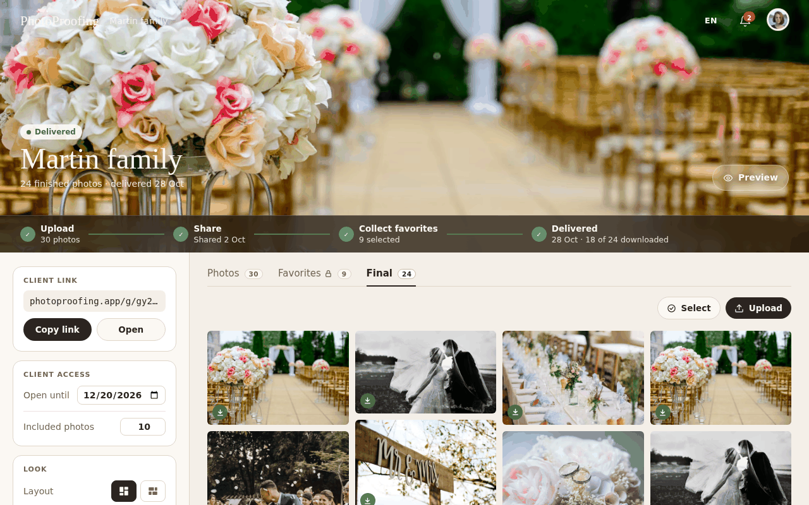
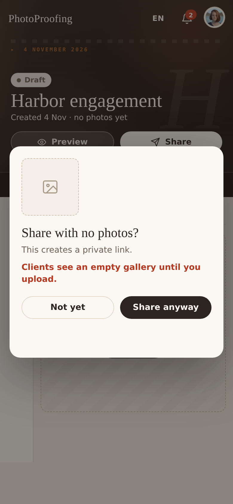
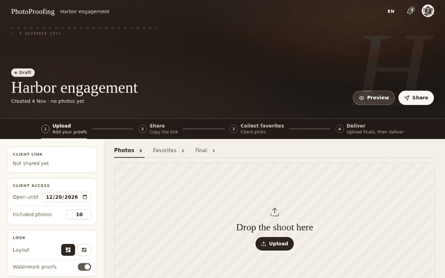

# Gallery

Where the photographer runs one shoot from upload to delivery. Route `/dashboard/{id}`
(prototype: `#/g/<id>/photos|favorites|final`).

The collection and dialog images below are historical prototype references, not the current
Studio layout.

| | Desktop | Phone |
|---|---|---|
| Photos |  |  |
| No hero |  |  |
| Uploading |  |  |
| Select |  |  |
| Updating watermarks |  |  |
| Favorites |  |  |
| Favorites, select |  |  |
| Final |  |  |
| Final, select |  |  |
| Direct Share confirmation |  |  |
| Publish confirmation |  |  |
| Delete |  |  |
| Side nav editing |  | |
| Photos in French |  |  |

## Studio layout: left rail and top journey bar

The gallery page uses the standard top `AppHeader` above a two-column Warm Paper studio workspace on
desktop (`md:`), collapsing to a single-DOM compact stack on `390 px` phones:

- **Left studio rail (`identity` + `nav`):**
  - The desktop rail stays visible across stages and matches the workspace sidebar: `16vw`,
    clamped to `240–280 px`.
  - `← Back to galleries` link and a framed cover thumbnail button showing the hero or a
    `CoverBackdrop` stand-in; clicking it opens **Design**. The gallery pin is at the bottom-right,
    status at the top-right and shoot date, if set, at the bottom-left.
  - The inline-editable gallery title is below the cover. `Last opened` stays separate below
    the title only after the first client visit.
  - **Collection** navigation with counts: **Photos**, **Favorites** (accented when over allowance,
    no owner padlock after publication), **Comments**, and **Final**. Favorites, Comments, Final and Studio
    Activity remain visible but disabled before the first share.
  - **Studio** navigation: **Design**, **Share** (disabled when archived), **Contacts** (with
    linked-contact count), **Activity**, and **Settings**.
  - On phones (`< md`), `nav` becomes a horizontally scrollable pill strip below the Journey bar.
- **Top Journey Wizard & action bar (`journey`):**
  - **Upload → Share → Collect favorites → Delivered** shortcuts open Photos, Share or Favorites when available, without publishing or sending email. Keep all four labels on phones; the contextual action can wrap.
  - There is no separate header Preview or Publish action. When archived, **Restore** replaces
    the Journey.

## Studio views (`Design`, `Share`, `Contacts`, and `Settings`)

| View / Card | Content |
|---|---|
| **Design** | **Cover** combines a live image and focal-point crosshair. Drag to reposition, releasing to save, or use arrow keys (Shift for larger increments). The **Select cover** / **Change cover** picker shows ready proofs, and the adjacent red **Remove cover** button clears the cover. **Cover style**, **Typography** font specimens, and **Photo Grid & Spacing** remain beside the live client preview. **Open full preview** opens the full client preview at every width |
| **Share** | A wide Warm Paper sheet with the **Invitation envelope** on the left and a read-only **Live email preview** on the right, stacked on phones. Only the envelope edits **To** (linked contacts, typed addresses, or the directory), optional private **BCC**, **Subject**, and **Personal message**. Preview shows stage-specific copy, the cover, metadata, access-code callout if enabled, and expiry; it never includes recipients. Proof readiness, missing SMTP and expiry are explained inline. **Publish** is a separate confirmed delivery action inside Share; **Send invitation** is always explicit |
| **Contacts** | Full-width linked contact list (monogram, **Name**, **Email**, optional **Phone**, **Unlink**) and one **Manage contacts** action. Its dialog searches the workspace, can create and link a contact, and links to **Manage directory** (`/contacts`). **Link** briefly becomes **Linked**, then **Unlink** in the same row; only in-flight requests disable the row action |
| **Settings → General** | **Shoot date**, **Open until** (date picker with one-click relative presets from 1 week to 1 year), then **Included photos** (number input, disabled once published), in separate rows; all optional |
| **Settings → Privacy & Protection** | **Client link** (Draft: `"Not shared yet"` + inline **Share link** button opening the direct-link confirmation dialog; once shared: link and **Copy**), **Require access code** (Draft: switch + 6-digit numeric input + **Generate** + **Copy**; once shared: locked read-only 6-digit monospace code + **Copy** when set, or disabled switch noting none can be added after sharing), and **Enable watermarks** switch |
| **Settings → Actions** | **Archive** (or **Restore**) and destructive **Delete**, each with a short consequence hint and confirmation dialog |

- Design uses a one-third controls / two-thirds live [preview](preview.md) split at
  `lg`, without a fixed-height or internally scrolling inline frame, including Phone mode.
  Below `lg` the inline stage is hidden; Design’s **Open full preview** still opens the full dialog.
- Collection and Studio panels stay mounted once opened so counts load on open and in-place edits,
  uploads, invitation drafts, or open viewers survive section switches and autosaves in the same
  gallery. Switching galleries starts a new editor and dismisses any open confirmations.
- Focal-point edits update the preview immediately; saves complete in order. If the latest save
  fails, the preview returns to the last saved point. Leaving the gallery still sends released
  saves to their original gallery but discards a drag that has not been released. If saves were
  still pending when you left, the focal control waits for the confirmed point when you return.
- In-place inputs save on change without success rings or repeated `"Saved"` toasts. An invalid
  value shows a red toast and reverts. A past `"Open until"` marks the gallery Expired; a future or
  cleared one lifts it.
- The watermark switch is the only watermark control here. Mark, repeat, position and size live in
  [Settings](settings.md) and apply to every gallery.

## Collection views (`Photos`, `Favorites`, `Comments`, `Final`)

Photos, Favorites and Final use a compact grid of cropped 3:2 tiles. The panel width determines
the number of columns: two below 36 rem, three from 36 rem, and four from 58 rem.

### Photos

The proofs. The toolbar keeps **Upload** visible, even in select mode. Besides the selection
circle, tiles show:

- a star at the top right: **Set as hero** / **Remove hero** (a toggle). On hover and focus only,
  except the hero's own star, which stays visible as a gold star with no text (its tooltip and
  screen-reader label are "Remove hero"). On touch screens use the viewer instead;
- a × to delete, which always asks first.

No hearts or favorite marks here: favorites belong to the Favorites tab. Clicking a photo opens
the [viewer](viewer.md).

**Empty:** a drop zone, "Drop the shoot here", **Upload**. Uploads and failures stay in the grid
beside existing photos; the drop zone only appears when both are empty.

**Upload:** each new tile goes Waiting → Uploading → Processing → ready, each with a label and an
indeterminate bar (no percentages, no overall counter). The status stays centered inside its
tile, above the bottom progress bar. A failed tile turns red, "Upload failed"
with the reason, a **Retry** button and ×; a red toast says "1 photo failed to upload."

**Updating watermarks:** after watermark settings change, all galleries show a slim
"Updating watermarks…" line with a small spinner in the toolbar until the marked proofs are
regenerated, even with watermarking off. Clean owner tiles, the open viewer and the hero remain
usable and unwatermarked. Unlike initial upload processing, regeneration keeps the photo visible
with a small bottom status badge; a failed regeneration includes **Retry**. Published render
revisions refresh client images without reloading the gallery; originals and finals stay
unwatermarked. Switching watermarking on or off only selects existing files.

### Favorites

Only the client's selection, most recent first and read-only. The stage header offers **Download all** when there are any
favorites. Hovering a photo shows a small download button
for that photo (always visible on touch). The empty state has a heart and "No favorites yet".
Opening a photo
shows the viewer with the favorite heart and the same individual-original download action.
The whole or selected subset uses one ZIP preparation slot: **Downloading…** is disabled from
the initial request until download initiation, with errors left visible and no separate success
message. If a ZIP status check fails, **Retry ZIP status** checks the same request without
starting a new one. If the requested ZIP is no longer available, the photographer can use
**Download** to request it again. Select-mode subsets always use a ZIP, even for one selected
photo; tile and viewer downloads stream the individual original with a busy download control.
Individual download errors appear separately from ZIP errors.

### Final

Finished photos are private until delivered. The photographer can upload and manage them, but the tab offers no download action. A passive mark and the first request date appear only on requested tiles, not in the viewer. The count is distinct current photos requested, not clicks or confirmed saves.

Use × to delete a photo, or the "Drop the finished photos here" zone to start an empty Final grid.

### Select mode

Start by pressing the 26 px circle at a tile's top left. It appears on hover or keyboard focus,
and is always visible on touch and while selecting. In select mode, the tile body toggles
selection instead of opening the viewer. The normal toolbar and tile positions stay put.

A floating bar shows **Exit selection**, the count and **Select all** (or **Unselect all**).
Photos and Final offer **Delete**, Favorites **Download**. These actions are disabled at
zero, but select mode stays open until exited with **✕** or Escape. Below 80 rem, gallery
actions use icons with accessible names and can wrap to fit clear of the rails.
Select all picks only photos currently shown in that tab and
does not include local queue items.

Confirming a photo deletion shows a disabled **Deleting…** button with a spinner and retains
the confirmed count.
Cancel and Escape cannot dismiss it while deletion runs; removed tiles shrink and fade unless
reduced motion is requested. Desktop journey steps are centered within the banner.

## Dialogs

Direct Share, Publish and Delete confirm. Direct Share and Publish never refuse: when nothing is ready
they warn and the button says "anyway". The "until 12 Sep" in the Share text only appears when
an Open until date is set.

Publish counts and warns about finals only; proofs do not contribute to that dialog.

| Dialog | Normal | Something missing |
|---|---|---|
| Share | "Share 48 photos?" "This creates a private link. Anyone with it can see the proofs and pick favorites until 12 Sep." **Cancel** / **Share** | "Share with no photos?" warning "Clients see an empty gallery until you upload." **Share anyway** |
| Publish | "Publish 20 photos?" "Camille & Hugo see them at the same link and can download them. Favorites are locked from now on." **Cancel** / **Publish** | "Publish with no photos?" **Publish anyway** |
| Delete photos | Stack of the photos, count; mentions client favorites only if one is a favorite | — |

Photos still uploading or failed are mentioned as a warning line ("2 are still uploading and 1
failed."). After **Settings → Privacy & Protection → Share link**, the photo stack flies out, a green
check pops and the dialog becomes "Your gallery is shared" with **Copy link**. Email invitations
live in **Studio → Share** when `[smtp]` is configured; SMS remains future scope. Confirming
**Publish** switches the existing client link from proofs to finals and updates the invitation
preview. It never sends email; use **Send invitation** separately if needed.
**Send invitation** keeps the selected recipients and copy through the photo-readiness check and
any **Send anyway** confirmation. If protection changes or its save fails after starting either
**Share link** or **Send invitation**, start the action again.

