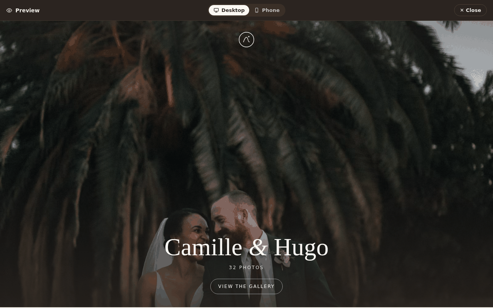
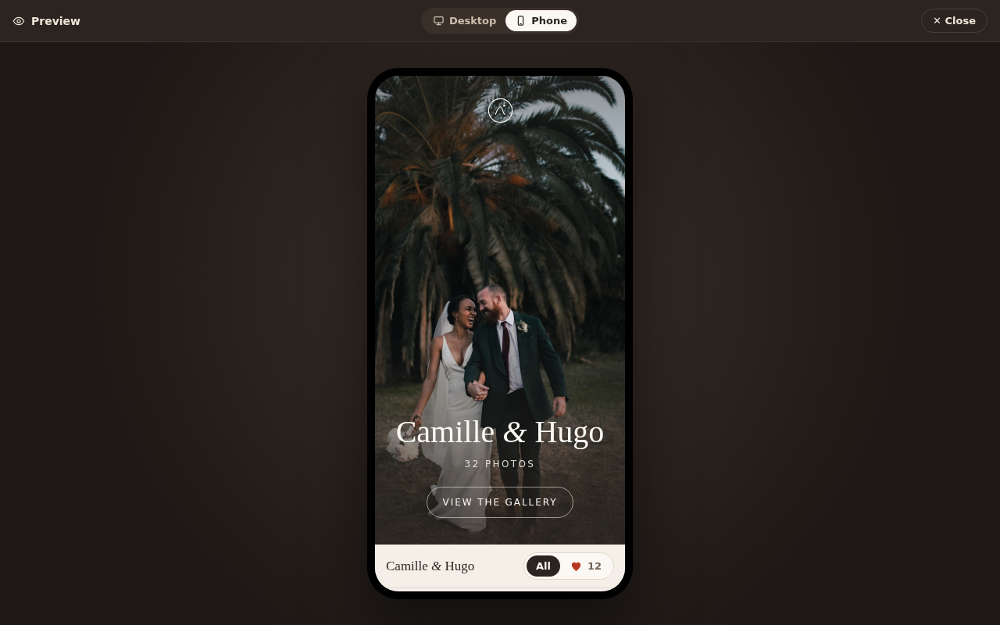

# Preview

The real [client page](client.md) shown inside the app, so the photographer sees what the client
will see, whatever the gallery's state. Opened by **Preview** in the gallery header.

| Desktop mode | Phone mode |
|---|---|
|  |  |

- Full-screen dark overlay. Its header has a "Preview" marker, a **Desktop** / **Phone** icon
  toggle and ✕. Esc closes and focus returns to the Preview button.
- Desktop shows the page at full width; Phone shows it in a centred phone-width frame that
  scrolls inside.
- A delivered gallery previews the delivered page.
- **Read-only.** Hearts and download buttons are shown, faded and not clickable (in the prototype
  only hearts are disabled; downloads must be too), so the
  photographer sees the client's current selection without being able to change it. The
  favorites filter and the viewer still work.
- Nothing is recorded: no link is created, no client activity, no notification.
- Saved studio signature settings and the normalized owner logo are shown exactly as on the
  client cover. When both are selected, the centered logo sits above the centered name.
