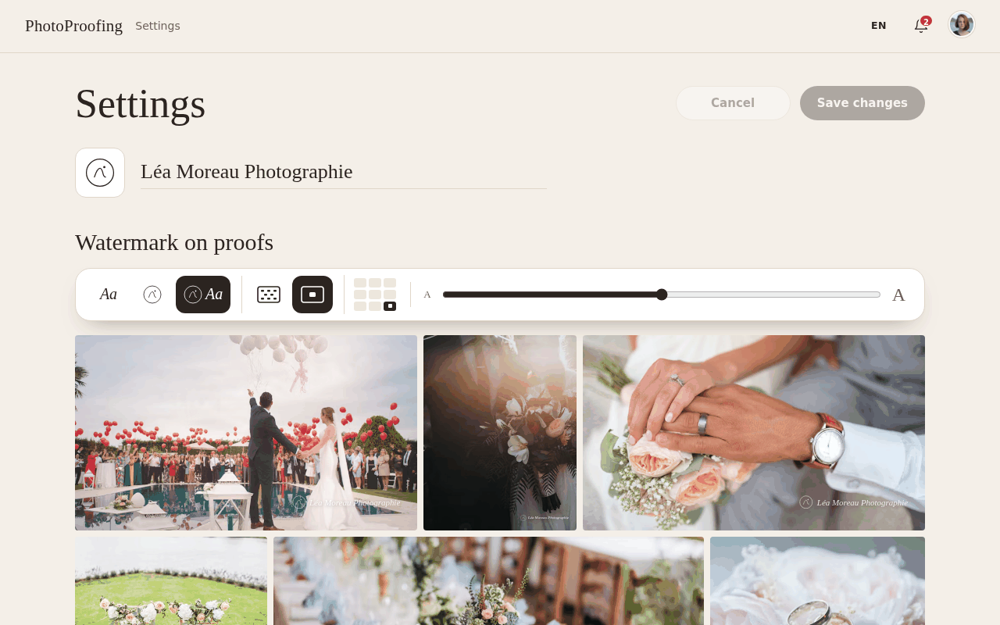
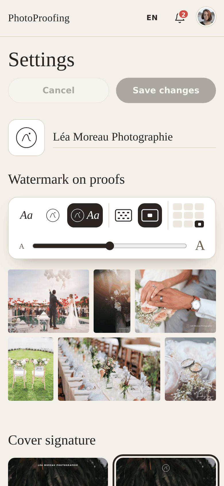
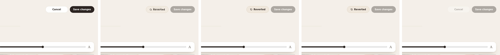

# Settings

Workspace settings shared by every gallery. Open `/settings` from **Settings** in the app
navigation (or the account menu on older screens).

The images below show the historical layout, not the current screen.

| | Desktop | Phone |
|---|---|---|
| Settings |  |  |
| Just saved |  |  |

## Layout

**Settings** has sticky **Cancel** and **Save changes** actions and four keyboard-navigable tabs:

- **Studio:** studio name and logo upload/removal.
- **Watermark:** Name, Logo or Both; Repeat or Once; a 3 × 3 position grid enabled for Once;
  ten size steps; opacity from 0–100%; and a paired text color picker and hex field.
- **Cover signature:** Name, Logo, Both or None, with ten size steps.
- **Proof quality:** the workspace's Low, Medium or High proof resolution and compression.

Mark and signature choices use a cream surface and a border/check for selection, without
tinting logos or losing transparency. Logo choices are disabled without a logo. There is one
shared live sample: on the right of the active controls on desktop, below them on a phone.
It shows the cover signature on its tab and the watermark on the other tabs. At 390 px the
tabs scroll horizontally; the controls and sample do not.

## Save and Cancel

- **Save changes** shows a spinner and disabled **Saving…** while pending; Cancel is also
  disabled until the request finishes. After success it shows "✓ Saved" for 1.6 s, not a toast.
  A partial hex value keeps the last valid preview and disables Save until it is corrected or
  canceled. Failed saves show a reason or a Retry action.
- Edits made during a save remain unsaved rather than being replaced by the earlier response.
  Save becomes available again for those edits; the Saved animation only appears when no
  newer edits remain.
- **Cancel** reverts every unsaved change; its undo icon spins back with "Reverted" for about
  1.4 s.

Per-gallery choices are limited to the **Watermark proofs** switch in the gallery's side nav; the
watermark design itself is the same for every gallery.

The footer shows the frontend's short build SHA and a button to copy the full
SHA. Clipboard failure offers manual copying. Unstamped local builds say
Development build. Build identity does not appear on client galleries.
