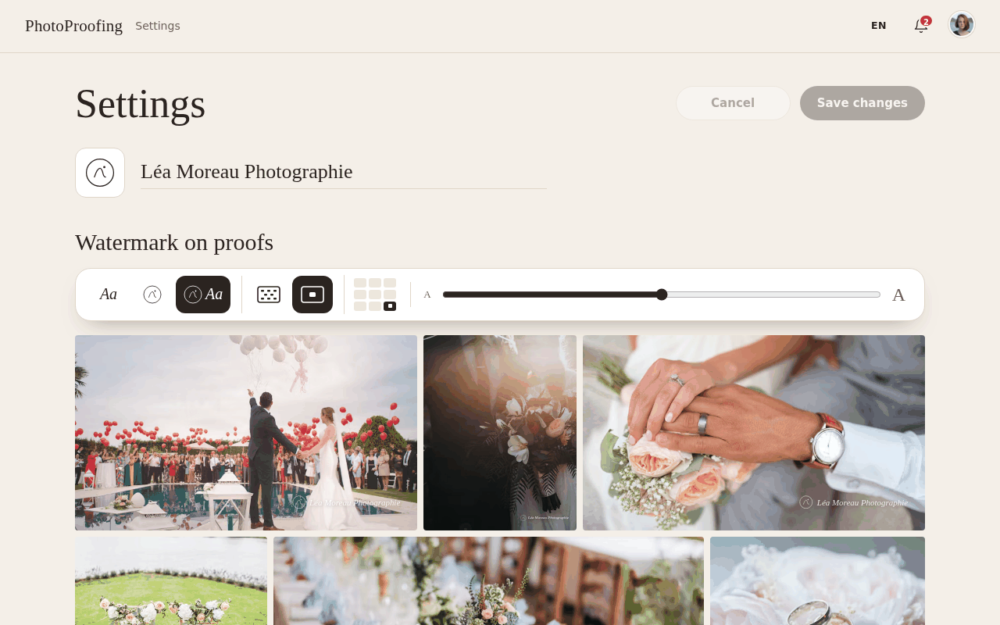
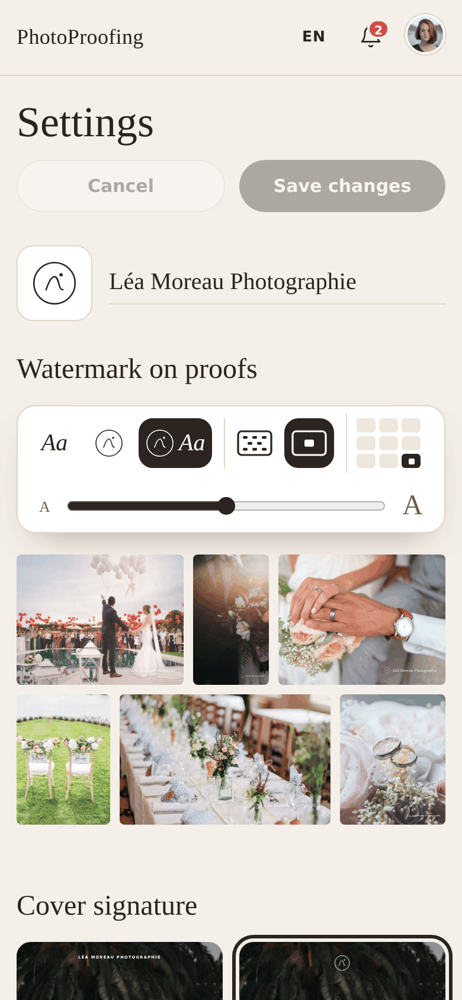
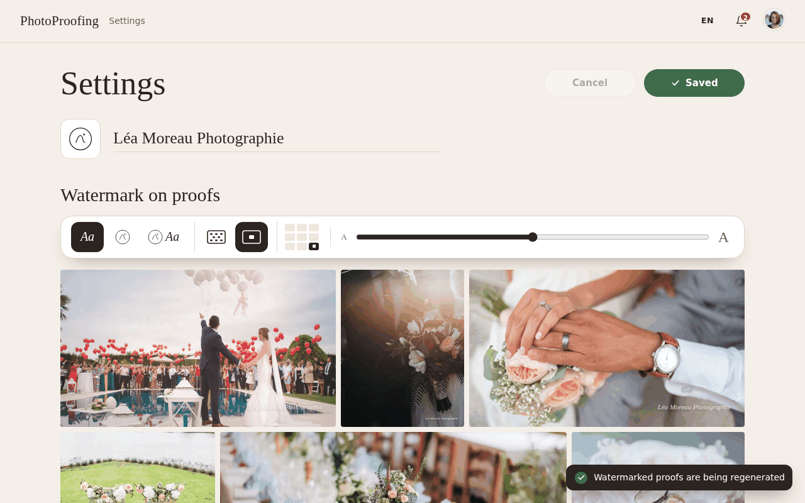
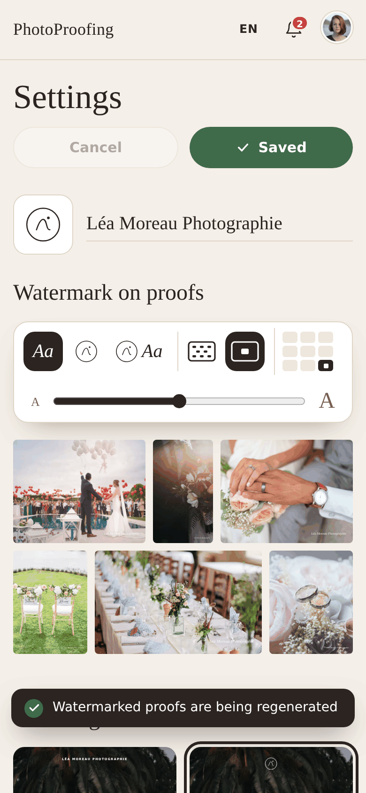
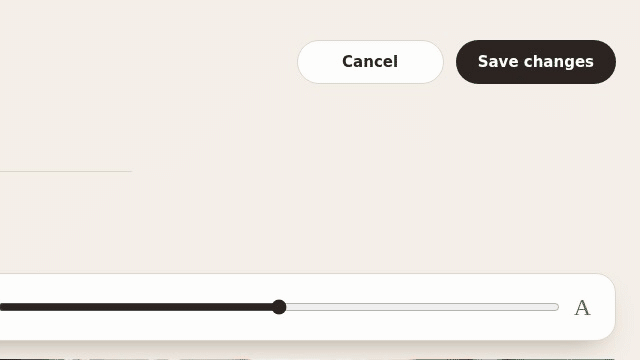
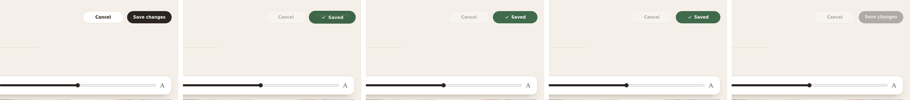
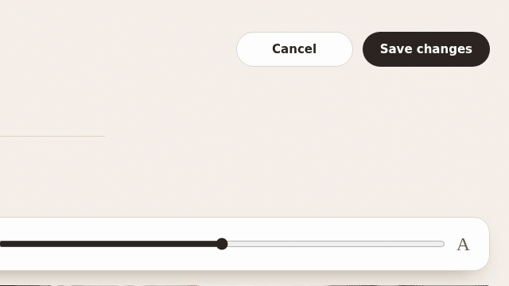
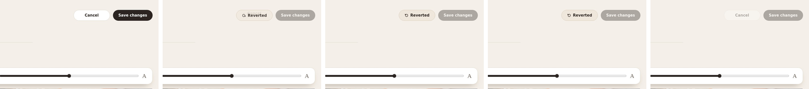

# Settings

Workspace settings shared by every gallery. Route `/settings`, from the account menu.

| | Desktop | Phone |
|---|---|---|
| Settings |  |  |
| Just saved |  |  |

## Layout

1. **Header:** "Settings" with **Cancel** and **Save changes** on the right, both disabled until
   something changes.
2. **Studio:** logo tile (upload, or the logo with a ✕ to remove) and the studio name input.
3. **Watermark on proofs:** a toolbar, then a live contact sheet of six sample proofs showing the
   result. The toolbar scrolls with the page; it is not sticky.

   | Group | Control |
   |---|---|
   | Mark | Icon buttons: name, logo, name and logo (logo options disabled without a logo) |
   | Pattern | Icon buttons: Repeat (tiled) or Once |
   | Position | 3 × 3 grid of dots; disabled while Repeat is on |
   | Size | Slider with a small and a large "A", five steps |

4. **Cover signature:** four mini client covers to pick how the studio signs the cover: Name,
   Logo, Both, None (logo options disabled without a logo).

## Save and Cancel

- **Save changes** shows a spinner and disabled **Saving…** while pending; Cancel is also
  disabled until the request finishes. After success it turns green with "✓ Saved" for about
  1.6 s. When the watermark changed, a toast
  adds "Watermarked proofs are being regenerated", and galleries with watermarking on show
  "Updating watermarks…" until done.
- Edits made during a save remain unsaved rather than being replaced by the earlier response.
  Save becomes available again for those edits; the Saved animation only appears when no
  newer edits remain.
- **Cancel** reverts every unsaved change; its undo icon spins back with "Reverted" for about
  1.4 s.

Per-gallery choices are limited to the **Watermark proofs** switch in the gallery's side nav; the
watermark design itself is the same for every gallery.

The footer shows the frontend's short build SHA and a button to copy the full
SHA. Clipboard failure offers manual copying. Unstamped local builds say
Development build. Build identity does not appear on client galleries.
