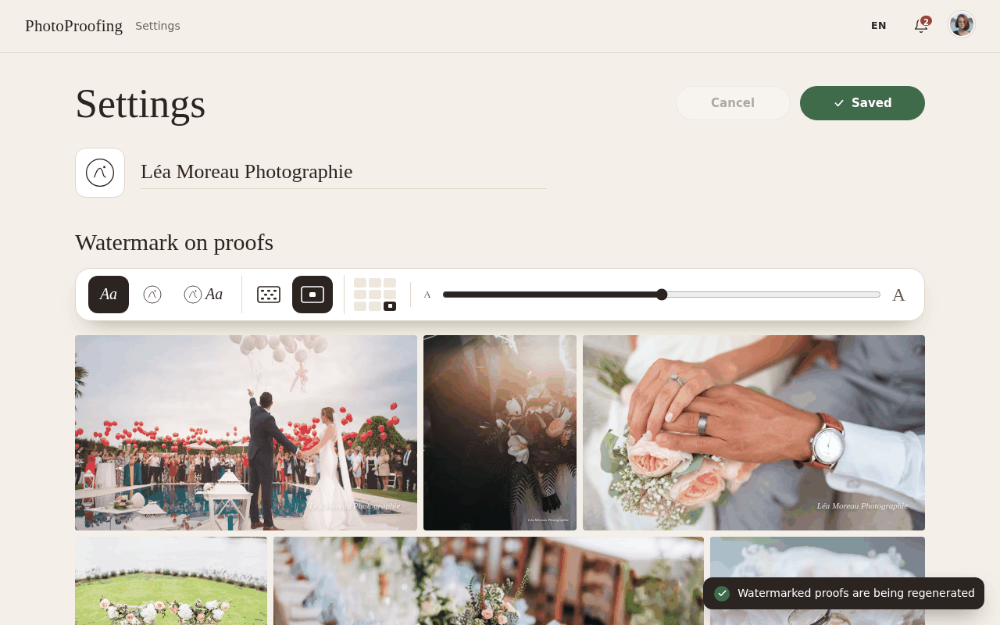
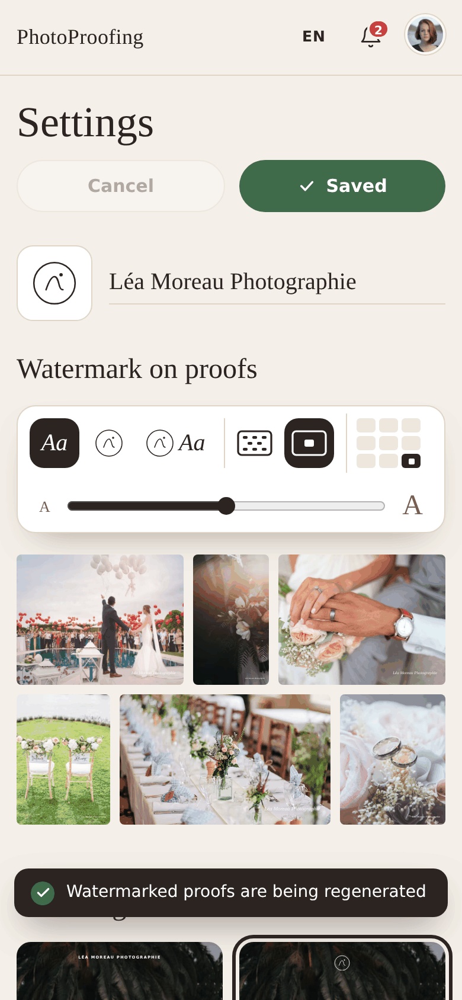
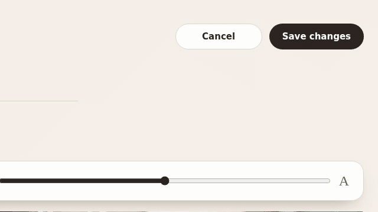
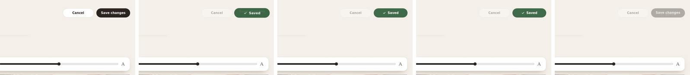
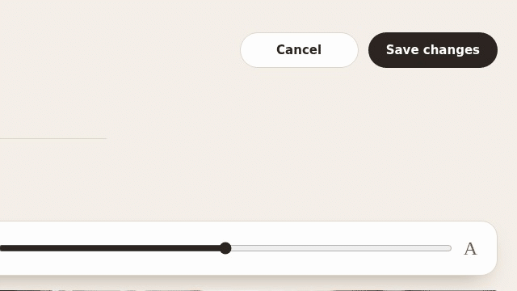

# Settings

Workspace settings shared by every gallery. Open `/settings` from **Settings** in the app
navigation (or the account menu on older screens).

The images below show the historical layout, not the current screen.

| | Desktop | Phone |
|---|---|---|
| Settings |  |  |
| Just saved |  |  |

## Layout

**Settings** has a full-width sticky **Cancel** and **Save changes** bar and three
keyboard-navigable sections. Both actions are disabled until there is an edit.

- **General:** studio name and logo, workspace language, and Low, Medium or High proof
  resolution and compression. Changing language reloads the page after the preference is saved.
- **Watermark:** Name, Logo or Both; Repeat or Once; nine positions shown on the preview
  only in Once; ten size steps; opacity from 5–100% on adjustment; and a text color picker
  with a hex field. Lower saved values stay as they are until adjusted.
- **Cover signature:** Name, Logo, Both or None, with ten size steps. Both centers the logo
  above the name. The name can use a custom text color; the reset icon restores the cover color.

The section menu shares the workspace navigation's white, cream-hover and warm-black
selected states. Mark and signature controls use the same palette without tinting logos.
Logo choices are disabled without a logo. The watermark and signature each have a compact
toolbar over a live preview; General has no preview.

## Save and Cancel

- **Save changes** shows a spinner and disabled **Saving…** while pending; Cancel is also
  disabled until the request finishes. After success it shows "✓ Saved" for 1.6 s, not a toast.
  A partial hex value keeps the last valid preview and disables Save until it is corrected or
  canceled. Failed saves show a reason or a Retry action.
- Edits made during a save remain unsaved rather than being replaced by the earlier response.
  Save becomes available again for those edits; the Saved animation only appears when no
  newer edits remain.
- **Cancel** reverts every unsaved change; its undo icon spins back with "Reverted" for about
  1.4 s.

Per-gallery choices are limited to the **Watermark proofs** switch in the gallery's side nav; the
watermark design itself is the same for every gallery.

The footer shows the frontend's short build SHA and a button to copy the full
SHA. Clipboard failure offers manual copying. Unstamped local builds say
Development build. Build identity does not appear on client galleries.
