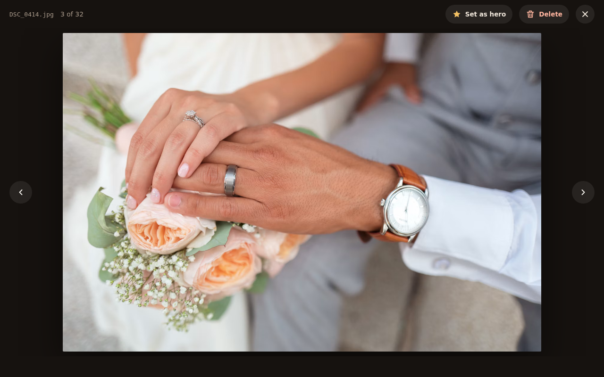
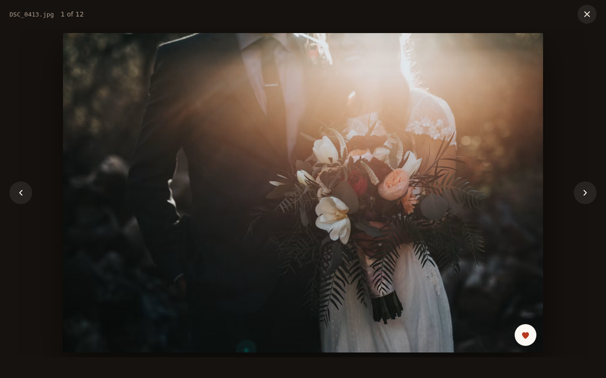
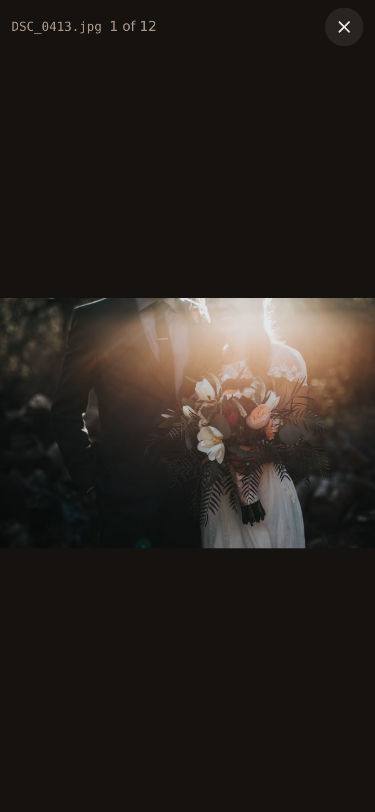
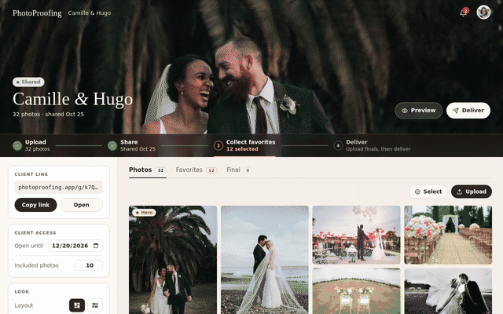
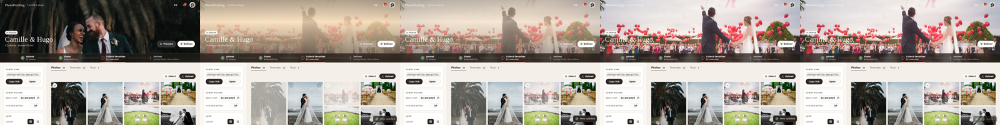

# Photo viewer

Full-screen dark viewer for one photo, opened by clicking a tile. The client's viewer is in
[client](client.md).

| | Desktop | Phone |
|---|---|---|
| From Photos |  |  |
| From Favorites |  |  |

## Layout

- **Top bar:** file name, "12 of 48", then the actions and ✕.
- **Stage:** the photo, as large as fits, with previous and next arrows (disabled at the ends).
  Arrow keys step, Esc closes.

## Actions by tab

| Opened from | Actions |
|---|---|
| Photos | **Set as hero** / **Remove hero** (toggle, star filled when it's the hero), **Delete**, **Comments** |
| Favorites | **Comments**; a read-only white heart on the photo shows it is a client favorite |
| Final | **Delete** |

Setting a hero updates the gallery header straight away; removing it brings back the no-hero
header. Delete confirms like everywhere else.

**Comments** shows the nondeleted count and opens a thread beside the photo on desktop or below
it on phones, without covering the image. It starts closed; toggling the button, pressing Escape
or changing photos closes it. Escape closes the thread before the viewer. The photographer can
reply and edit/delete her own replies; deleted messages retain their text, struck through.
New client comments refresh an open thread without clearing a draft. Finals have no comments.

## States

- Still processing: a spinner instead of the photo.
- Processing failed: "This photo could not be processed" with **Try again**.
